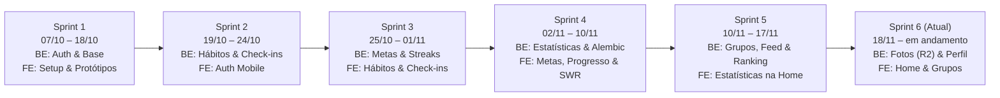

# Acompanhamento de Desenvolvimento — Sprints

Esta seção consolida o histórico de execução das **Sprints do projeto HABBIT** pela **Equipe Shannon**, documentando o planejamento, as entregas realizadas nas frentes de **Back-end** e **Front-end**, as **decisões técnicas e de produto** tomadas em cada ciclo, a evolução das suítes de testes e a apuração das **métricas GQM** (`M1`, `M2` e `M3`).

---

## 1. Modelo de Execução (Ciclo Defasado BE $\rightarrow$ FE)

Desde a **Sprint 1**, a equipe adotou o **desacoplamento intencional de uma sprint entre Back-end e Front-end**: o Back-end projeta, implementa, testa e documenta os contratos REST (OpenAPI + guias de fechamento de sprint) com uma iteração de antecedência, permitindo que o Front-end consuma rotas estáveis na sprint seguinte.

Embora o planejamento inicial previsse fechamento às quartas-feiras, na prática a equipe consolidou as integrações e validações de fim de sprint entre **sexta-feira à noite e o fim de semana**, preservando a entrega semanal contínua com pipelines de CI verdes.

---

## 2. Resumo Consolidado das Sprints

| Sprint | Período Real | Escopo Back-end | Escopo Front-end | M1 (TCS) | M2 (TRT) | M3 (DTA) | Situação |
| :---: | :---: | :--- | :--- | :---: | :---: | :---: | :---: |
| **[Sprint 1](sprints/sprint-01.md)** | `07/10` – `18/10` | Base monorepo, Docker/CI e Autenticação (`AUTH-1`–`AUTH-8`) | Estudo da stack, setup Expo, tema e protótipos | **100,0%** (8/8) | **12,5%** (1/8) | **1** | Concluída ✅ |
| **[Sprint 2](sprints/sprint-02.md)** | `19/10` – `24/10` | Hábitos e Check-ins N:N (`HAB-1`–`HAB-8`) | Autenticação mobile (`#5`, `#30`–`#33`) | **100,0%** (13/13) | **15,4%** (2/13) | **2** | Concluída ⚠️ |
| **[Sprint 3](sprints/sprint-03.md)** | `25/10` – `01/11` | Metas e Motor de Streaks (`GOAL-1`–`GOAL-8` + `PR #81`) | Hábitos e Check-ins mobile (`#49`–`#54`) | **100,0%** (14/14) | **14,3%** (2/14) | **1** | Concluída ✅ |
| **[Sprint 4](sprints/sprint-04.md)** | `02/11` – `10/11` | Estatísticas, Calendário e Alembic (`STAT-1`–`STAT-9`) | Metas, Progresso e SWR (`#92`–`#98` + `PR #91`) | **93,8%** (15/16) | **13,3%** (2/15) | **1** | Concluída ✅ |
| **[Sprint 5](sprints/sprint-05.md)** | `10/11` – `17/11` | Grupos, Feed, Ranking e Stats (`GRP-1`–`GRP-12`) | Estatísticas na Home (`#132`–`#134`, `#141`) | **87,5%** (14/16) | **14,3%** (2/14) | **2** | Parcial ⚠️ |
| **[Sprint 6](sprints/sprint-06.md)** | `18/11` – *atual* | Fotos no Check-in (Cloudflare R2) e Perfil (`FOTO-1`–`7`, `PERF-1`–`3`, `QA-1`) | Pendências da Home + consumo de Grupos | *Em andamento* | *Em apuração* | *Em redução* | Em andamento 🔄 |

Para análise detalhada dos indicadores, histórico completo de débitos técnicos (`DT-01` a `DT-05`) e tomada de decisão gerencial, consulte o **[Painel Consolidado de Métricas GQM](metricas-coletas.md)**.

---

## 3. Evolução da Base de Código e Testes Automatizados

Ao longo das cinco primeiras sprints concluídas, a suíte de testes automatizados cresceu de forma contínua em ambas as frentes:

| Marco | Funções de Teste na API (`pytest`) | Suítes de Teste no Mobile (`jest`) | Destaque de Qualidade |
| :---: | :---: | :---: | :--- |
| **Sprint 1** | **85** testes (`auth`) | Setup inicial | Introdução de Testcontainers (PostgreSQL 17 descartável) e CI (`api-tests.yaml`). |
| **Sprint 2** | **114** testes (`auth` + `habits` + `checkins`) | Autenticação (`auth-context`, `api`, `token-storage`) | Validação de privacidade `404`/`403` e transações "tudo ou nada" em check-ins. |
| **Sprint 3** | **111** funções de teste (com testes parametrizados de `goals`) | Fluxos de hábitos e check-ins (`check-in`, `habits-check-ins-api`, `duration`) | Testes unitários puros para o motor de streaks (`day`, `week`, `month`) e relógio fixo. |
| **Sprint 4** | **196** funções (**233** casos coletados) | Metas, progresso, `user` e `calendar` | Testes automatizados de migrações Alembic (`test_migrations.py`) e limite fixo de queries SQL. |
| **Sprint 5** | **452** funções (**64** arquivos de teste na API) | **152** casos de teste em **25** arquivos (`statistics-panel`, `useUserStatistics`, etc.) | Testes de concorrência (`SELECT ... FOR UPDATE`), cursor opaco de feed, ranking e matriz de permissões. |
