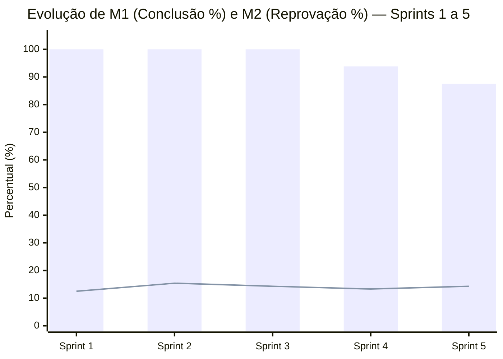

# Acompanhamento de Métricas (GQM) — Coletas e Evidências

Esta página consolida as **medições reais** do programa **GQM (*Goal-Question-Metric*)** definido em [Seção 4 — Métricas e Medições (GQM)](../visao-produto/metricas-gqm.md), cobrindo as **Sprints 1 a 5 concluídas** e o acompanhamento parcial da **Sprint 6** (ainda em apuração), com rastreabilidade direta para Issues, Pull Requests, commits e relatórios de QA do repositório.

---

## 1. Critérios Auditáveis de Coleta

Para garantir consistência e transparência sem introduzir sobrecarga operacional na equipe, todas as medições são extraídas diretamente de artefatos públicos do repositório (`Issues`, `Pull Requests`, `GitHub Actions`, histórico Git e documentos de fechamento de sprint):

| Métrica | Meta | Regra Objetiva de Apuração | Fonte Auditável |
| :--- | :---: | :--- | :--- |
| **M1 — Taxa de Conclusão da Sprint (TCS)** | $\ge 90\%$ | Contabiliza apenas as **sub-issues atômicas de entrega** planejadas para a sprint (excluindo épicos/guarda-chuva como `#1`, `#2`, `#20`, `#47`, `#48`, `#78`, `#79` e `#128` para evitar dupla contagem). Um item conta como *Done* quando sua implementação foi concluída e integrada no ciclo da sprint (incluindo `#133`, entregue no [PR #142](https://github.com/FGA0138-MDS-Ajax/2026.2-T02-Shannon/pull/142)). | Issues e PRs no GitHub (`FGA0138-MDS-Ajax/2026.2-T02-Shannon`) |
| **M2 — Taxa de Reprovação nos Testes (TRT)** | $\le 20\%$ | Percentual das entregas testadas na sprint que apresentaram falha em testes/CI, revisão corretiva ou defeito registrado na verificação de QA antes da liberação final. | PRs/commits corretivos (`fix`), runs do GitHub Actions e relatórios de QA das sprints |
| **M3 — Débito Técnico em Aberto (DTA)** | $\le 1\text{ item}$ | Contagem absoluta de itens estruturais de débito técnico em aberto ao encerramento da sprint: **(a)** soluções provisórias ou atalhos arquiteturais que exigem refatoração; e **(b)** suítes de testes automatizados pendentes. | Relatórios de fechamento de sprint, catálogo de limites conhecidos e issues abertas |

---

## 2. Histórico Consolidado de Coletas (Sprints 1 a 6)

| Sprint | Período | Planejadas (BE + FE) | Concluídas (Done) | M1 — TCS ($\ge 90\%$) | M2 — TRT ($\le 20\%$) | M3 — DTA ($\le 1$) | Classificação |
| :---: | :---: | :---: | :---: | :---: | :---: | :---: | :---: |
| **[Sprint 1](sprints/sprint-01.md)** | `07/10` – `18/10` | `8` (8 BE) | `8` | **100,0%** | **12,5%** (1/8) | **1** (`DT-01`) | Atendido ✅ |
| **[Sprint 2](sprints/sprint-02.md)** | `19/10` – `24/10` | `13` (8 BE + 5 FE) | `13` | **100,0%** | **15,4%** (2/13) | **2** (`DT-01`, `DT-02`) | Atenção ⚠️ |
| **[Sprint 3](sprints/sprint-03.md)** | `25/10` – `01/11` | `14` (8 BE + 6 FE) | `14` | **100,0%** | **14,3%** (2/14) | **1** (`DT-01`) | Atendido ✅ |
| **[Sprint 4](sprints/sprint-04.md)** | `02/11` – `10/11` | `16` (9 BE + 7 FE) | `15` | **93,8%** | **13,3%** (2/15) | **1** (`DT-03`) | Atendido ✅ |
| **[Sprint 5](sprints/sprint-05.md)** | `10/11` – `17/11` | `16` (12 BE + 4 FE) | `14` | **87,5%** | **14,3%** (2/14) | **2** (`DT-04`, `DT-05`) | Atenção ⚠️ |
| **[Sprint 6](sprints/sprint-06.md)** | `18/11` – *atual* | `11` BE *(+ pendências FE)* | `11` BE concluídas *(apuração final em aberto)* | *Em andamento* | *Em apuração* | *Em redução* | Em andamento 🔄 |
| **Acumulado (S1–S5)** | `07/10` – `17/11` | **`67` issues** | **`64` entregues** | **95,5%** | **14,1%** (9/64) | **2 em aberto** | **Controlado** |

### Evolução Gráfica de M1 (TCS) e M2 (TRT)

*(Barras: **M1 — Taxa de Conclusão da Sprint**, meta $\ge 90\%$. Linha: **M2 — Taxa de Reprovação nos Testes**, meta $\le 20\%$.)*

---

## 3. Rastreamento de Evidências por Métrica

### 3.1. Evidências de M2 (Reprovações em Testes / Revisão)

| Sprint | Ocorrência Registrada | Evidência no Repositório | Resolução |
| :---: | :--- | :--- | :--- |
| **S1** | Modularização do gerenciamento de sessões e ajuste de variáveis de ambiente no CI | [PR #23](https://github.com/FGA0138-MDS-Ajax/2026.2-T02-Shannon/pull/23), commit `6df547c` | Corrigido e integrado à `developer` |
| **S2** | Bug de ordem do validador `NoNul` + `StringConstraints` aceitando strings só de espaços | [PR #43](https://github.com/FGA0138-MDS-Ajax/2026.2-T02-Shannon/pull/43), commit `493638f` | Corrigido antes do merge da S2 |
| **S2** | Divergência na rota `/auth/session/me` na integração do aplicativo mobile | [PR #63](https://github.com/FGA0138-MDS-Ajax/2026.2-T02-Shannon/pull/63) | Corrigido e validado em `developer` |
| **S3** | Ajustes no formato do campo `progress` no `POST /check-ins`, testes e lint Ruff (`GOAL-7`/`GOAL-8`) | Commits `9d86d6a`, `9291c50`, `0beb543` | Corrigido antes do merge [PR #77](https://github.com/FGA0138-MDS-Ajax/2026.2-T02-Shannon/pull/77) |
| **S3** | Limpeza de estado do formulário de criação de hábito ao sair da tela mobile | Commit `2338f19` | Corrigido na integração mobile |
| **S4** | Validação de anos limite (`0000-01`/`9999-12`) no calendário mensal (`STAT-7`) | Commit `6fb6054` | Corrigido antes do merge [PR #114](https://github.com/FGA0138-MDS-Ajax/2026.2-T02-Shannon/pull/114) |
| **S4** | Limpeza de estado de erro de *retry* na tela de detalhe do hábito mobile | Commit `4ce8782` ([PR #129](https://github.com/FGA0138-MDS-Ajax/2026.2-T02-Shannon/pull/129)) | Corrigido na suíte de testes de metas |
| **S5** | Bug `L1` (`GRP-10`): `progress.status` de hábito de grupo sai `"ended"` em `GET /habits` e `GET /goals/.../progress` | Documentado na bateria de QA `GRP-11` ([PR #147](https://github.com/FGA0138-MDS-Ajax/2026.2-T02-Shannon/pull/147)) | Contorno documentado (`GRP-12`); correção alocada em `DT-04` |
| **S5** | Bug `L2` (`GRP-5`): `code` não-string (`12345678` ou `null`) retorna HTTP `500` em `POST /groups/join` | Documentado na bateria de QA `GRP-11` ([PR #147](https://github.com/FGA0138-MDS-Ajax/2026.2-T02-Shannon/pull/147)) | Correção alocada em `DT-04` |

### 3.2. Ciclo de Vida dos Débitos Técnicos (`M3 — DTA`)

| ID | Descrição do Débito Técnico | Categoria | Abertura | Quitação | Situação Atual |
| :---: | :--- | :---: | :---: | :---: | :---: |
| **DT-01** | Ausência de migrações versionadas de banco de dados (criação provisória via `create_all` no `lifespan`, exigindo `DROP TABLE` manual em mudanças de schema). | Solução provisória | **Sprint 1** | **Sprint 4** ([PR #104](https://github.com/FGA0138-MDS-Ajax/2026.2-T02-Shannon/pull/104) — Alembic + `test_migrations.py`) | Quitado ✅ |
| **DT-02** | Cobertura reduzida de testes automatizados para casos de borda de hábitos e check-ins (apenas 10 testes na S2, com validações manuais). | Testes pendentes | **Sprint 2** | **Sprint 3** ([PR #76](https://github.com/FGA0138-MDS-Ajax/2026.2-T02-Shannon/pull/76) — expansão das suítes de integração) | Quitado ✅ |
| **DT-03** | Suíte automatizada de testes de metas e streaks no Front-end pendente ([Issue #98](https://github.com/FGA0138-MDS-Ajax/2026.2-T02-Shannon/issues/98)). | Testes pendentes | **Sprint 4** | **Sprint 5** ([PR #129](https://github.com/FGA0138-MDS-Ajax/2026.2-T02-Shannon/pull/129)) | Quitado ✅ |
| **DT-04** | Refatoração estrutural dos arquivos híbridos de `app/group/` (`groups.py`, `members.py`, etc. para separação estrita `service.py`/`router.py`) + correção dos bugs `L1` e `L2` encontrados no QA da S5. | Refatoração / Correção | **Sprint 5** | *Prevista na Sprint 6* | Em aberto ⚠️ |
| **DT-05** | Testes automatizados do painel de estatísticas na Home mobile ([Issue #134](https://github.com/FGA0138-MDS-Ajax/2026.2-T02-Shannon/issues/134)). | Testes pendentes | **Sprint 5** | **Sprint 6** ([Issue #134](https://github.com/FGA0138-MDS-Ajax/2026.2-T02-Shannon/issues/134), fechada em 24/11) | Quitado ✅ |

---

## 4. Análise Crítica e Tomada de Decisão (Interpretação *Bottom-Up*)

1. **Estabilidade de Entrega nas Sprints 1 a 4 (`M1` entre `93,8%` e `100%`):**
   O fatiamento em issues pequenas (`AUTH-1..8`, `HAB-1..8`, `GOAL-1..8`, `STAT-1..9`) e o desacoplamento de uma sprint entre Back-end e Front-end mantiveram a previsibilidade acima da meta ($\ge 90\%$) em 4 ciclos consecutivos, atingindo **95,5%** de conclusão acumulada nas Sprints 1 a 5.
2. **Controle Consistente da Qualidade na Entrada de Testes (`M2` sempre $\le 20\%$):**
   Em todas as cinco sprints concluídas, a Taxa de Reprovação nos Testes manteve-se entre **12,5%** e **15,4%** (média acumulada de **14,1%**), sempre abaixo do limite de `20%`. O uso de **Pytest + Testcontainers**, **Jest + RNTL**, **Ruff**, **Biome** e a exigência de revisão por PR evitaram regressões críticas na `developer`.
3. **Ciclo de Abertura e Quitação de Débito Técnico (`M3`):**
   - Na **Sprint 2**, o `DTA` subiu para `2` (`DT-01` + `DT-02`). A equipe reagiu na Sprint 3 quitando `DT-02` e na Sprint 4 quitando `DT-01` com a implantação definitiva do **Alembic**.
   - Na **Sprint 4**, o único item pendente (`DT-03` — `#98`) foi resolvido logo no início da Sprint 5 ([PR #129](https://github.com/FGA0138-MDS-Ajax/2026.2-T02-Shannon/pull/129)).
4. **Acionamento Real do Replanejamento na Virada da Sprint 5 $\rightarrow$ Sprint 6:**
   A Sprint 5 concentrou o maior volume técnico do projeto (21 novas rotas de grupos no Back-end + painel completo de estatísticas no Front-end), levando `M1` a **87,5%** e `M3` a **2 itens** (`DT-04`, `DT-05`). Em conformidade direta com o **Gatilho 1** de [Critérios de Replanejamento](../visao-produto/cronograma-riscos.md#33-criterios-de-replanejamento), a equipe **reduziu o escopo imediato da Sprint 6** — priorizando **Fotos (Cloudflare R2)**, **Perfil** e a quitação dos débitos abertos, e realocando **Lembretes (`US-25`)** para a etapa seguinte.
