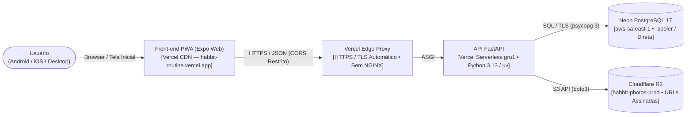

# Visão de Implantação, CI/CD e Restrições Adicionais

Esta seção descreve a topologia de infraestrutura em nuvem e local do **HABBIT**, os fluxos de Integração Contínua (CI) no **GitHub Actions**, a publicação manual em produção (`scripts/deploy.sh`) e as restrições operacionais adicionais do sistema.

---

## 1. Visão de Implantação em Produção

Em produção, o **HABBIT** opera integralmente em serviços gerenciados (*serverless* e *object storage*), com custo zero em planos gratuitos, HTTPS automático na borda, sem NGINX e sem administração manual de servidores:

- **Front-end — Entrega Oficial (`apps/mobile`, PWA na Vercel):** Desenvolvido em TypeScript com **React Native (`0.88.1`)**, **Expo (`~58.0`)** e **Expo Router**, compilado para Web estática (`web.output: "static"`) como **Progressive Web App (PWA)** instalável e publicado no projeto **`habbit-web`** da Vercel (`https://habbit-routine.vercel.app`).
- **Borda Gerenciada (Vercel Edge Proxy):** Substitui o NGINX previsto originalmente, fornecendo terminação **TLS/HTTPS** automática, compressão HTTP, roteamento SPA/estático e repasse do IP real via `X-Forwarded-For`.
- **Back-end (`apps/api`, Vercel Hobby `gru1`):** API **FastAPI** em **Python 3.13** gerenciada por **uv**, publicada como função *serverless* no projeto **`habbit-api`** da Vercel (`https://habbit-api.vercel.app`) na região **São Paulo (`gru1`)**, com `CORS_ORIGINS` restrito à URL da PWA e `pool_pre_ping=True` no SQLAlchemy.
- **Banco de Dados (`Neon Free`, PostgreSQL 17, `aws-sa-east-1`):** Banco relacional PostgreSQL 17 co-localizado em São Paulo, acessado em execução via URL com **`-pooler`** (`DATABASE_URL`, `sslmode=require`) e driver **psycopg 3**. As migrações **Alembic** (`alembic upgrade head`) rodam durante o build de produção (`scripts/vercel_build.py`, somente quando `VERCEL_ENV=production`) usando a conexão direta sem pooler (`DIRECT_DATABASE_URL`).
- **Armazenamento de Mídia (`Cloudflare R2`):** *Object storage* S3-compatível (bucket privado `habbit-photos-prod`) acessado via `boto3` para hospedar fotos e miniaturas de check-ins com URLs temporárias assinadas.

*Figura 07 – Topologia de implantação em produção na Vercel, Neon e Cloudflare R2 (sem NGINX). Fonte: elaborado pelos autores (2026).*

### Ambiente de Desenvolvimento Local (`docker-compose.yml`)

No ambiente de desenvolvimento local, a orquestração utiliza **Docker Compose** para subir o banco de dados **PostgreSQL 17** com configuração idêntica na máquina da equipe, enquanto a API FastAPI executa localmente via `uv run fastapi dev` (com `STORAGE_BACKEND=memory` quando não há credenciais R2) e o aplicativo móvel via `pnpm --filter mobile start`.

---

## 2. Pipelines de Integração Contínua (CI) e Publicação Manual

O repositório conta com quatro *workflows* automatizados no **GitHub Actions** e um script local de publicação em produção:

| Fluxo / Script | Gatilho | Escopo e Etapas Executadas |
| :--- | :--- | :--- |
| **`api-tests.yaml`** | Push / PR (`apps/api/**`) | Configura Python 3.13 e `uv`, instala dependências do Back-end e executa a suíte completa do **Pytest** (incluindo testes de integração com **Testcontainers** subindo PostgreSQL 17 real e validação de migrações **Alembic**). |
| **`mobile-tests.yaml`** | Push / PR (`apps/mobile/**`) | Configura Node.js 22 e `pnpm`, instala dependências do workspace, executa `tsc --noEmit` e roda a suíte de testes unitários e de componentes com **Jest** e **React Native Testing Library**. |
| **`lint.yaml`** | Push / PR | Verifica a formatação e as regras de lint em Python com **Ruff** (PEP 8) e em TypeScript/React Native com **Biome**. |
| **`ci.yml` (branch `docs`)** | Push na branch `docs` | Instala `mkdocs-material` e `mkdocs-minify-plugin`, compila a documentação estática e publica automaticamente na branch `gh-pages` (`mkdocs gh-deploy --force`). |
| **`scripts/deploy.sh` (manual)** | Execução manual pelo mantenedor na `main` | **Não é CD completo.** Valida branch `main` limpa e alinhada a `origin/main`, confirma que todos os checks do CI do commit passaram, publica a API (`habbit-api`, aplicando `alembic upgrade head` no Neon durante o build), verifica `GET /` (`200 "OK"`), publica a PWA (`habbit-web`) e valida a resposta HTTP. |

> **Motivo da publicação manual:** nenhum token da Vercel é armazenado no repositório ou nos *Secrets* do GitHub Actions, pois usuários com permissão de escrita poderiam acessar esses segredos via workflows. A autenticação ocorre exclusivamente pelo login local da Vercel CLI (`vercel login`) na máquina do mantenedor, sem conectar o repositório Git aos projetos da Vercel.

---

## 3. Restrições Adicionais e Limitações Conhecidas

1. **Entrega Oficial em PWA (Expo Web):** A entrega oficial publicada em produção é a **PWA (`https://habbit-routine.vercel.app`)**, permitindo acesso imediato via navegador e instalação na tela inicial em Android, iOS e desktop sem depender da aprovação das lojas oficiais.
2. **Sessão Web em `localStorage` (Provisória):** No navegador não existe o cofre nativo `expo-secure-store`. O arquivo `src/services/token-storage.web.ts` utiliza `localStorage` **provisoriamente** para a apresentação (decisão alinhada com a liderança técnica do projeto); trata-se de uma limitação de segurança conhecida e não da solução definitiva.
3. **Limpeza de Fotos Órfãs Manual:** A rotina `python -m app.photos.sweep` não possui agendamento automático nesta entrega e deve ser executada manualmente (sempre rodando `--dry-run` antes e nunca apontando o bucket de produção para outro banco).
4. **Limites dos Planos Gratuitos:** Operação sujeita às cotas do **Neon Free** (1 GB de armazenamento, 100 CU-horas/mês, suspensão após 5 min de inatividade) e da **Vercel Hobby** (4 CPU-horas ativas/mês, teto de 4,5 MB por requisição — fotos limitadas a 4 MB na API).
5. **Acesso Mediado por Autenticação:** Todas as funcionalidades de negócio (hábitos, metas, check-ins, estatísticas, calendário e grupos) exigem usuário registrado e autenticado (`Signup` / `Login`) com sessão válida no servidor.
