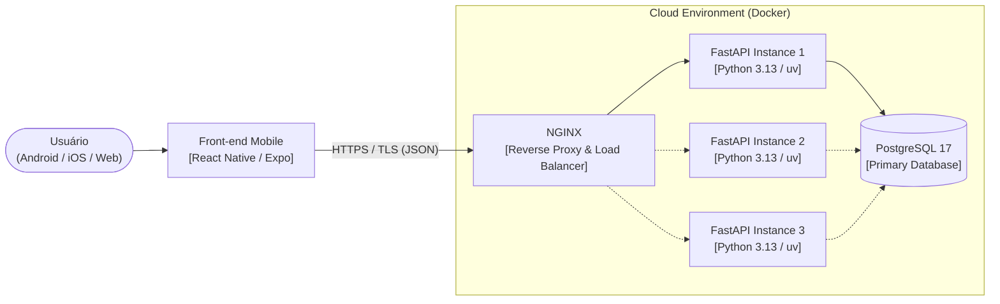
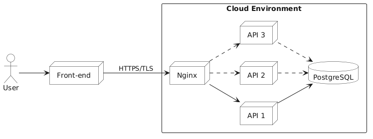

# Visão de Implantação, CI/CD e Restrições Adicionais

Esta seção descreve a topologia de infraestrutura em nuvem e local do **HABBIT**, os fluxos de Integração e Entrega Contínua (CI/CD) no **GitHub Actions** e as restrições operacionais adicionais do sistema.

---

## 1. Visão de Implantação

O sistema **HABBIT** foi projetado para operar de forma padronizada por meio de contêineres **Docker**:

- **Front-end (`apps/mobile`):** Desenvolvido em TypeScript com **React Native (`0.86`)**, **Expo (`~57.0`)** e **Expo Router**, permitindo compilação multiplataforma para dispositivos Android, iOS e execução em navegador Web.
- **Gateway e Proxy Reverso (`NGINX`):** Em ambiente de nuvem (produção/homologação), atua na borda da infraestrutura gerenciando certificados TLS/HTTPS e distribuindo a carga entre múltiplas réplicas da API.
- **Back-end (`apps/api`):** Desenvolvido em **Python 3.13+** com **FastAPI**, **SQLModel**, **Pydantic v2**, **Alembic** e driver **psycopg 3**, gerenciado pelo **uv**.
- **Banco de Dados (`PostgreSQL 17`):** SGBD relacional responsável pela persistência transacional ACID.

*Figura 07 – Topologia da infraestrutura em nuvem com NGINX, instâncias de API e PostgreSQL. Fonte: elaborado pelos autores (2026).*

### Ambiente de Desenvolvimento Local (`docker-compose.yml`)

No ambiente de desenvolvimento local, a orquestração utiliza **Docker Compose** para subir o banco de dados **PostgreSQL 17** com configuração idêntica em todas as máquinas da equipe, enquanto a API FastAPI executa em instância única via `uv run fastapi dev` e o aplicativo móvel via `pnpm --filter mobile start`.

---

## 2. Pipelines de Integração e Entrega Contínua (GitHub Actions)

O repositório conta com quatro *workflows* automatizados no **GitHub Actions**:

| Workflow | Gatilho | Escopo e Etapas Executadas |
| :--- | :--- | :--- |
| **`api-tests.yaml`** | Push / PR na branch `developer` (`apps/api/**`) | Configura Python 3.13 e `uv`, instala dependências do Back-end e executa a suíte completa do **Pytest** (incluindo testes de integração com **Testcontainers** subindo PostgreSQL 17 real e validação de migrações **Alembic**). |
| **`mobile-tests.yaml`** | Push / PR na branch `developer` (`apps/mobile/**`) | Configura Node.js e `pnpm`, instala dependências do workspace e executa a suíte de testes unitários e de componentes com **Jest** e **React Native Testing Library**. |
| **`lint.yaml`** | Push / PR na branch `developer` | Verifica a formatação e as regras de lint em Python com **Ruff** (PEP 8) e em TypeScript/React Native com **Biome** / `expo lint`. |
| **`ci.yml` (branch `docs`)** | Push na branch `docs` | Instala `mkdocs-material` e `mkdocs-minify-plugin`, compila a documentação estática e publica automaticamente na branch `gh-pages` (`mkdocs gh-deploy --force`). |

---

## 3. Restrições Adicionais

1. **Foco em Experiência Mobile:** O sistema tem como plataforma primária dispositivos móveis (**Android e iOS**), especialmente devido à ergonomia do check-in rápido e ao sistema de notificações locais. Embora o Expo permita execução em navegador Web (com *fallback* automático de `expo-secure-store` para `localStorage`), o uso via navegador destina-se primordialmente ao desenvolvimento, homologação e visualização de componentes no Storybook.
2. **Acesso Mediado por Autenticação:** Todas as funcionalidades de negócio (hábitos, metas, check-ins, estatísticas, calendário e grupos) exigem usuário devidamente registrado e autenticado (`Signup` / `Login`) com sessão válida no servidor.
