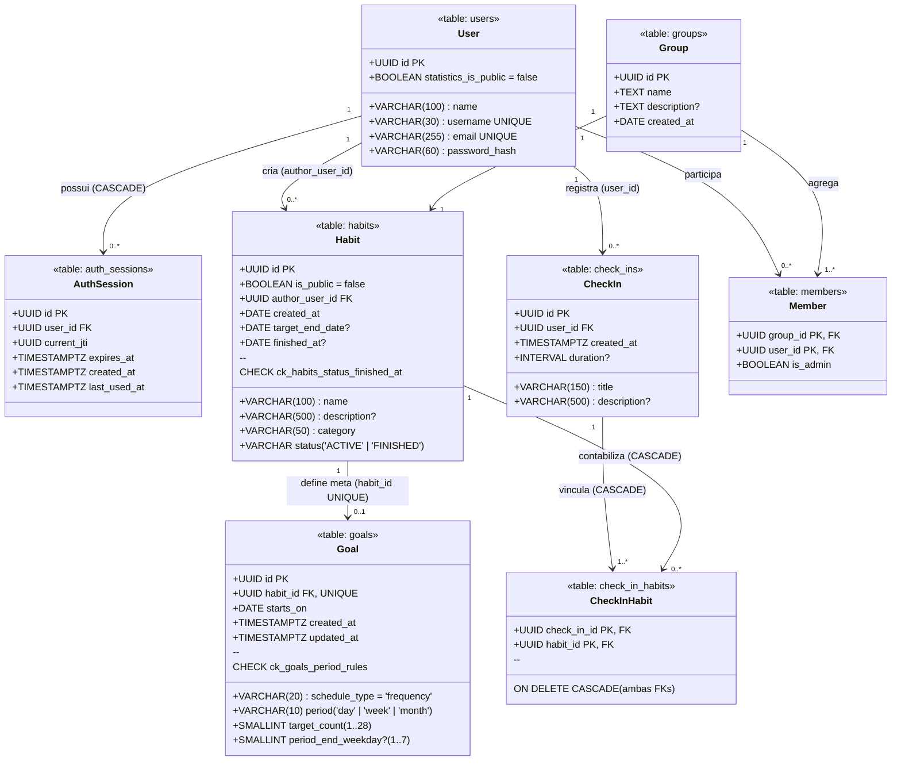
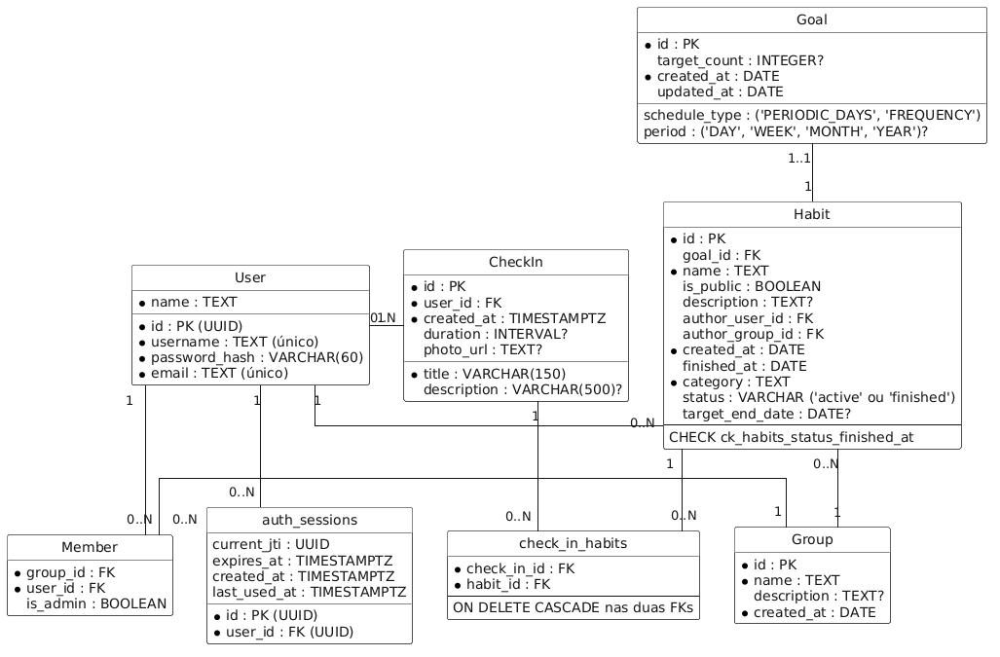

# Visão Estrutural e Modelo de Dados

Esta seção documenta o esquema relacional do banco de dados **PostgreSQL 17** do sistema **HABBIT** na **Versão 3.0**, detalhando suas tabelas, colunas, tipos, relacionamentos, restrições de integridade (`CHECK` e `FOREIGN KEY`) e o fluxo de migrações com **Alembic**.

---

## 1. Diagrama Entidade-Relacionamento / Classes de Domínio (Versão 3.0)

!!! info "Evolução do Esquema na Versão 3.0"
    Em relação à versão 2.0 do documento, o modelo de dados implementado em código consolidou três aprimoramentos importantes:
    
    1. **Relação 1:1 `habits` $\leftrightarrow$ `goals`:** A chave estrangeira fica na tabela `goals` (`habit_id UUID UNIQUE NOT NULL REFERENCES habits(id) ON DELETE CASCADE`), e não como `goal_id` em `habits`.
    2. **Regras de Período em `goals`:** Adicionadas as colunas `period` (`'day'`, `'week'`, `'month'`), `period_end_weekday` (`SMALLINT`, de 1 a 7 para metas semanais) e `starts_on` (`DATE`), protegidas pela constraint `ck_goals_period_rules`.
    3. **Privacidade de Estatísticas em `users`:** Adicionada a coluna `statistics_is_public` (`BOOLEAN NOT NULL DEFAULT false`) via migração Alembic.




*Figura 06 – Diagrama original do banco de dados (v2.0). Fonte: elaborado pelos autores (2026).*

---

## 2. Dicionário de Dados e Restrições de Integridade

### 2.1. Tabela `users` (`app/auth/models.py`)

Armazena os dados cadastrais e credenciais dos usuários registrados.

| Coluna | Tipo no PostgreSQL | Nulo? | Restrições / Índices | Descrição |
| :--- | :--- | :---: | :--- | :--- |
| `id` | `UUID` | Não | `PRIMARY KEY` | Identificador único gerado via UUID v4. |
| `name` | `VARCHAR(100)` | Não | — | Nome de exibição do usuário. |
| `username` | `VARCHAR(30)` | Não | `UNIQUE` | Identificador público normalizado (minúsculas, sem espaços). |
| `email` | `VARCHAR(255)` | Não | `UNIQUE` | Endereço de e-mail único normalizado em minúsculas. |
| `password_hash` | `VARCHAR(60)` | Não | — | Hash da senha com *salt* gerado pelo algoritmo **bcrypt**. |
| `statistics_is_public` | `BOOLEAN` | Não | `DEFAULT false` | Indica se as estatísticas do usuário são visíveis publicamente. |

---

### 2.2. Tabela `auth_sessions` (`app/auth/session/models.py`)

Registra cada sessão de autenticação ativa, permitindo renovação segura por *refresh token* e detecção de reuso.

| Coluna | Tipo no PostgreSQL | Nulo? | Restrições / Índices | Descrição |
| :--- | :--- | :---: | :--- | :--- |
| `id` | `UUID` | Não | `PRIMARY KEY` | Identificador da sessão (`sid` no payload do JWT). |
| `user_id` | `UUID` | Não | `FK -> users.id (ON DELETE CASCADE)`, `INDEX` | Usuário proprietário da sessão. |
| `current_jti` | `UUID` | Não | — | Identificador (`jti`) do *refresh token* vigente; rotacionado a cada `/auth/refresh`. |
| `expires_at` | `TIMESTAMPTZ` | Não | — | Data e hora limite de validade da sessão. |
| `created_at` | `TIMESTAMPTZ` | Não | `DEFAULT now()` | Instante de criação da sessão (login ou signup). |
| `last_used_at` | `TIMESTAMPTZ` | Não | `DEFAULT now()` | Instante da última renovação de tokens. |

---

### 2.3. Tabela `habits` (`app/habits/models.py`)

Representa os hábitos criados pelos usuários, com status de ciclo de vida e categoria validada.

| Coluna | Tipo no PostgreSQL | Nulo? | Restrições / Índices | Descrição |
| :--- | :--- | :---: | :--- | :--- |
| `id` | `UUID` | Não | `PRIMARY KEY` | Identificador único do hábito. |
| `name` | `VARCHAR(100)` | Não | — | Nome do hábito. |
| `description` | `VARCHAR(500)` | Sim | `DEFAULT NULL` | Descrição detalhada opcional. |
| `category` | `VARCHAR(50)` | Não | Catálogo `HabitCategory` | Uma das 16 categorias predefinidas (`D-08`). |
| `is_public` | `BOOLEAN` | Não | `DEFAULT false` | Define se outros usuários autenticados podem visualizar o hábito. |
| `status` | `VARCHAR` | Não | `INDEX`, `'ACTIVE'` ou `'FINISHED'` | Estado atual do hábito. |
| `author_user_id` | `UUID` | Não | `FK -> users.id (ON DELETE CASCADE)`, `INDEX` | Autor criador do hábito. |
| `created_at` | `DATE` | Não | — | Data de criação no fuso `America/Sao_Paulo`. |
| `target_end_date` | `DATE` | Sim | `DEFAULT NULL` | Data alvo opcional planejada pelo autor. |
| `finished_at` | `DATE` | Sim | `DEFAULT NULL` | Data em que o hábito foi encerrado via `POST /habits/{id}/finish`. |

**Constraint de Coerência (`ck_habits_status_finished_at`):**
```sql
CHECK (
  (status = 'ACTIVE' AND finished_at IS NULL) OR
  (status = 'FINISHED' AND finished_at IS NOT NULL)
)
```

---

### 2.4. Tabela `goals` (`app/goals/models.py`)

Armazena a regra de meta vigente de cada hábito (relação 1:1 com `habits`).

| Coluna | Tipo no PostgreSQL | Nulo? | Restrições / Índices | Descrição |
| :--- | :--- | :---: | :--- | :--- |
| `id` | `UUID` | Não | `PRIMARY KEY` | Identificador único da meta. |
| `habit_id` | `UUID` | Não | `FK -> habits.id (ON DELETE CASCADE)`, `UNIQUE` | Hábito ao qual a meta pertence (1 meta por hábito). |
| `schedule_type` | `VARCHAR(20)` | Não | `DEFAULT 'frequency'` | Tipo de agenda (atualmente `'frequency'`). |
| `period` | `VARCHAR(10)` | Não | `'day'`, `'week'` ou `'month'` | Janela de avaliação da meta (`GoalPeriod`). |
| `target_count` | `SMALLINT` | Não | `1` (dia), `1..7` (semana), `1..28` (mês) | Quantidade de dias cumpridos exigida por período. |
| `period_end_weekday` | `SMALLINT` | Sim | `1..7` (apenas quando `period = 'week'`) | Dia da semana em que o ciclo semanal fecha (`1 = Seg ... 7 = Dom`). |
| `starts_on` | `DATE` | Não | — | Data de início de vigência a partir da qual os check-ins contam. |
| `created_at` | `TIMESTAMPTZ` | Não | `DEFAULT now()` | Instante de criação do registro. |
| `updated_at` | `TIMESTAMPTZ` | Não | `DEFAULT now()`, `onupdate now()` | Instante da última alteração da meta. |

**Constraint de Regras por Período (`ck_goals_period_rules`):**
```sql
CHECK (
  (period = 'day' AND target_count = 1 AND period_end_weekday IS NULL) OR
  (period = 'week' AND target_count BETWEEN 1 AND 7
   AND period_end_weekday IS NOT NULL AND period_end_weekday BETWEEN 1 AND 7) OR
  (period = 'month' AND target_count BETWEEN 1 AND 28
   AND period_end_weekday IS NULL)
)
```

---

### 2.5. Tabelas `check_ins` e `check_in_habits` (`app/checkins/models.py`)

Modelam os registros de execução dos usuários e sua associação N:N com os hábitos.

#### Tabela `check_ins`

| Coluna | Tipo no PostgreSQL | Nulo? | Restrições / Índices | Descrição |
| :--- | :--- | :---: | :--- | :--- |
| `id` | `UUID` | Não | `PRIMARY KEY` | Identificador único do check-in. |
| `user_id` | `UUID` | Não | `FK -> users.id (ON DELETE CASCADE)`, `INDEX` | Autor do check-in. |
| `title` | `VARCHAR(150)` | Não | — | Título descritivo da atividade realizada. |
| `description` | `VARCHAR(500)` | Sim | `DEFAULT NULL` | Observações ou relato opcional da execução. |
| `created_at` | `TIMESTAMPTZ` | Não | `DEFAULT now()` | Carimbo exato de data e hora com fuso horário. |
| `duration` | `INTERVAL` | Sim | `DEFAULT NULL` | Tempo dedicado à atividade (recebido em ISO 8601, ex.: `PT45M`). |

#### Tabela Associativa `check_in_habits`

| Coluna | Tipo no PostgreSQL | Nulo? | Restrições / Índices | Descrição |
| :--- | :--- | :---: | :--- | :--- |
| `check_in_id` | `UUID` | Não | `PK Composta`, `FK -> check_ins.id (ON DELETE CASCADE)` | Referência ao check-in. |
| `habit_id` | `UUID` | Não | `PK Composta`, `FK -> habits.id (ON DELETE CASCADE)`, `INDEX` | Referência ao hábito contabilizado. |

!!! tip "Preservação de Histórico na Exclusão de Hábito (`D-11`)"
    Graças à modelagem da tabela associativa `check_in_habits` com `ON DELETE CASCADE` em ambas as chaves estrangeiras, quando um usuário exclui definitivamente um hábito (`DELETE /habits/{id}`), apenas os vínculos na tabela `check_in_habits` são apagados, preservando intactos os registros em `check_ins` e seus vínculos com outros hábitos.
