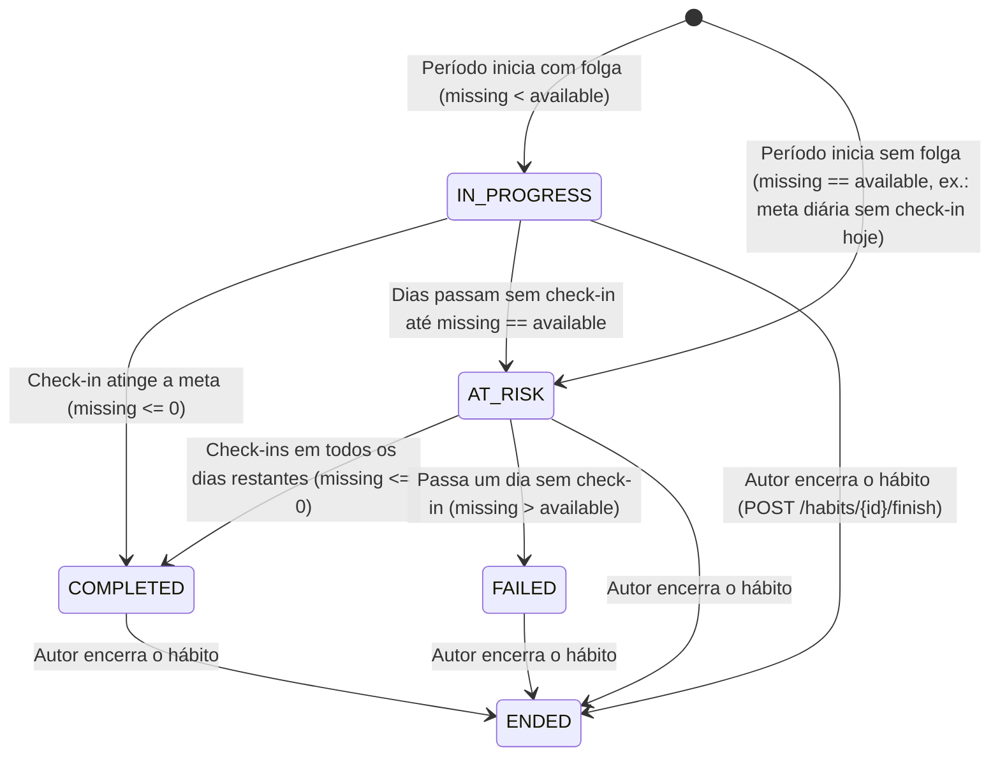

# Motor de Metas, Streaks e Estatísticas

O diferencial técnico central do **Web Server** do **HABBIT** reside no seu **motor determinístico de metas, streaks e estatísticas** (`app/goals/streak.py` e `app/statistics/calculations.py`).

Em vez de armazenar contadores mutáveis no banco de dados — que facilmente sofrem dessincronização na virada do dia, em edições/exclusões retroativas de check-ins ou em trocas de meta —, **todo o progresso e as sequências são calculados sob demanda em memória**, a partir do conjunto de dias com check-in no fuso horário `America/Sao_Paulo`.

---

## 1. Delimitação de Períodos (`period_bounds`)

Dado um objeto `GoalRule` (`period`, `target_count`, `period_end_weekday`, `starts_on`) e uma data qualquer $d$, a função `period_bounds(goal, d)` determina o intervalo fechado $[\text{start}, \text{end}]$ do período ao qual $d$ pertence:

- **Meta Diária (`period = 'day'`):**
  $$[\text{start}, \text{end}] = [d, d]$$
- **Meta Semanal (`period = 'week'`):**
  Calcula os dias restantes até o dia da semana de fechamento configurado (`period_end_weekday` $\in \{1..7\}$, onde $1 = \text{segunda}$ e $7 = \text{domingo}$):
  $$\Delta = (\text{period\_end\_weekday} - \text{isoweekday}(d)) \bmod 7$$
  $$\text{end} = d + \Delta\text{ dias}, \quad \text{start} = \text{end} - 6\text{ dias}$$
- **Meta Mensal (`period = 'month'`):**
  Do primeiro ao último dia do mês calendário de $d$:
  $$\text{start} = (d.\text{year}, d.\text{month}, 1), \quad \text{end} = (d.\text{year}, d.\text{month}, \text{last\_day\_of\_month})$$

---

## 2. Máquina de Estados do Período Atual (`ProgressStatus`)

Para calcular o progresso de um hábito (`calculate_progress`), o motor define a data de referência como:

$$\text{reference} = \text{finished\_at} \text{ (se o hábito estiver encerrado)} \quad \text{ou} \quad \text{today} \text{ (no fuso America/Sao\_Paulo)}$$

São filtrados apenas os dias distintos com check-in dentro da vigência da meta:

$$\text{valid\_days} = \{ d \in \text{days} \mid \text{starts\_on} \le d \le \text{reference} \}$$

Para o período atual $[\text{start}, \text{end}]$ que contém $\text{reference}$, calcula-se:

- **$\text{done}$:** quantidade de dias distintos em $\text{valid\_days}$ cujo período termina em $\text{end}$;
- **$\text{missing} = \text{target\_count} - \text{done}$:** quantos dias cumpridos ainda faltam no período;
- **$\text{available} = (\text{end} - \text{reference}).\text{days} + 1 - \mathbb{I}(\text{reference} \in \text{valid\_days})$:** quantos dias livres ainda restam até o fim do período (o dia de hoje só conta como livre se ainda não houve check-in hoje).

| Estado (`ProgressStatus`) | Condição Matemática | Significado para o Usuário |
| :---: | :---: | :--- |
| **`ended`** | `finished_at is not None` | O hábito foi encerrado pelo autor; o cálculo fica congelado na data `finished_at`. |
| **`completed`** | `missing <= 0` | A meta do período atual (`done >= target_count`) já foi cumprida! |
| **`failed`** | `missing > available` | Não há mais dias livres suficientes no período atual para alcançar `target_count`. |
| **`at_risk`** | `missing == available` | Atenção: faltam exatamente tantos check-ins quanto dias livres restantes (precisa fazer check-in hoje e em todos os dias até `end`). |
| **`in_progress`** | `missing < available` | Em andamento com folga: ainda faltam check-ins, mas há mais dias livres do que o necessário. |

---

## 3. Cálculo de Streaks e Dias de Constância

Um período encerrado em `p_end` é considerado **cumprido (`is_met`)** quando $\text{done\_by\_end}[\text{p\_end}] \ge \text{target\_count}$.

1. **Sequência Atual (`current_streak`):**
   - Se o período atual $[\text{start}, \text{end}]$ já estiver cumprido (`is_met(end)`), `current_streak` inicia em `1`; caso contrário, inicia em `0` (**sem zerar** a sequência anterior enquanto o período atual ainda estiver aberto).
   - Em seguida, um cursor recua período a período ($\text{cursor} \leftarrow \text{p\_start} - 1\text{ dia}$) somando `+1` enquanto `is_met(p_end)` for verdadeiro, parando no primeiro período não cumprido.
2. **Maior Sequência (`best_streak`):**
   - Percorre em ordem cronológica todos os períodos cumpridos (`is_met`) desde `starts_on`, incrementando a sequência quando o fim do período anterior coincide com $\text{p\_start} - 1\text{ dia}$ e registrando o máximo global.
3. **Início da Sequência (`streak_started_on`) e Dias de Constância (`consistent_days`):**
   - Identifica o primeiro dia de check-in do período mais antigo da sequência atual (ou do período atual, caso seja uma retomada com `current_streak == 0` e `done > 0`).
   - Calcula os dias corridos de constância:
     $$\text{consistent\_days} = (\text{reference} - \text{streak\_started\_on}).\text{days} + 1$$

---

## 4. Motor de Estatísticas e Calendário Mensal (`app/statistics/`)

### 4.1. Modos de Janela (`calendar` vs. `rolling`)

Na rota `GET /user/statistics`, os cartões de resumo semanal e mensal suportam dois modos (`StatisticsMode`):

- **`calendar` (Padrão):** A semana compreende da segunda-feira até hoje (`today - weekday`), e o mês compreende do dia `1` do mês atual até hoje.
- **`rolling` (Janela Móvel):** A semana compreende os últimos **7 dias** (`today - 6 dias` até `today`) e o mês compreende os últimos **30 dias** (`today - 29 dias` até `today`).

### 4.2. Taxa de Cumprimento de Metas (`period_results`)

Para avaliar a taxa de cumprimento (`CompletionRate`: `completed_periods`, `total_periods`, `rate`) em uma janela de `days` dias (`1` a `365`):

- **Períodos já fechados** dentro da janela entram sempre no denominador (`total_periods`);
- **O período atual em aberto** e o **primeiro período parcial** (quando a meta começou no meio de uma semana ou mês) **só entram na conta se já tiverem sido cumpridos (`met = True`)**, evitando penalizar injustamente o usuário por um período que ainda não acabou.

### 4.3. Estados do Calendário Mensal (`GET /user/statistics/habits/{id}/calendar`)

Para cada dia $d$ do mês consultado (`YYYY-MM`), o motor atribui exatamente um `CalendarDayState`:

| Estado (`CalendarDayState`) | Regra de Classificação |
| :---: | :--- |
| **`outside`** | O dia $d$ está fora do tempo de vida da meta/hábito: $d < \text{starts\_on}$, ou $d > \text{finished\_at}$, ou $d > \text{today}$. |
| **`completed`** | O usuário fez check-in no dia $d$ **e** o período da meta que contém $d$ atingiu `done >= target_count`. |
| **`partial`** | O usuário fez check-in no dia $d$, **mas** o período da meta que contém $d$ ainda não atingiu `target_count` (ocorre em metas semanais e mensais). |
| **`none`** | O dia $d$ está dentro da vigência do hábito/meta, mas não possui check-in registrado. |
