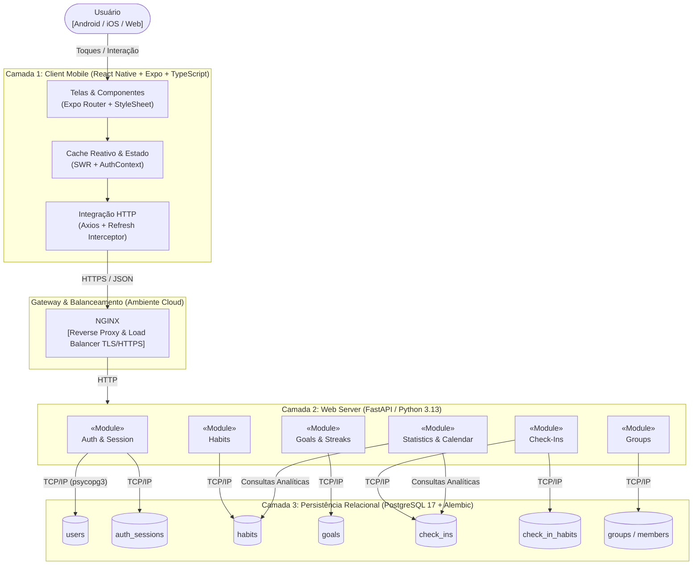
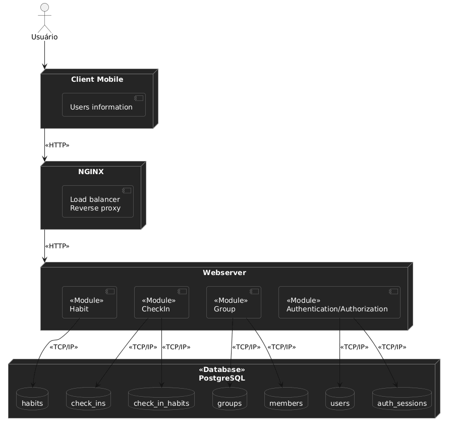

# Arquitetura do Sistema — Visão Geral, Metas e Restrições

Este documento descreve a arquitetura do sistema **HABBIT**, desenvolvido pela **Equipe Shannon** na disciplina de **Métodos de Desenvolvimento de Software (MDS)** da **UnB / FCTE** (`2026.2`). Seu propósito é oferecer uma visão técnica abrangente a desenvolvedores, testadores, avaliadores e demais partes interessadas, registrando as decisões arquiteturais adotadas e suas justificativas na **Versão 3.0**.

---

## 1. Propósito e Escopo Arquitetural

O **HABBIT** é um aplicativo móvel multiplataforma (**Android**, **iOS** e **Web** via React Native com Expo) voltado ao acompanhamento de hábitos. A arquitetura aqui documentada sustenta diretamente todos os requisitos essenciais (**Must**) e importantes (**Should/Could** antecipados) do sistema:

- **Cadastro, autenticação e gestão de sessões** (`C1-RF-01`, `C1-RF-02`, `C1-RNF-01` a `C1-RNF-03`);
- **Criação e gestão de hábitos e metas periódicas (`day`, `week`, `month`)** (`C2-RF-03` a `C2-RF-05`);
- **Registro de check-ins multi-hábito (com duração ISO 8601) e cálculo de streaks** (`C3-RF-06` a `C3-RF-08`, `C7-RF-19`);
- **Painel diário, estatísticas consolidadas e calendário mensal** (`C4-RF-09`, `C4-RF-10`);
- **Grupos de hábito compartilhado, participação e ranking** (`C5-RF-11` a `C5-RF-13`);
- **Lembretes de hábito pendente e perfil do usuário** (`C6-RF-14`, `C7-RF-15`).

---

## 2. Representação Arquitetural (Três Camadas)

O sistema adota uma **arquitetura cliente-servidor em três camadas**: **Client Mobile (Front-end)**, **Web Server (Back-end, precedido por NGINX em nuvem)** e **Banco de Dados Relacional (PostgreSQL 17)**. Essa escolha prioriza simplicidade operacional, desacoplamento de contratos via REST/JSON e evolução modular sem prejuízo à performance ou à escalabilidade horizontal.

*Figura 01 – Diagrama original de implementação em três camadas. Fonte: elaborado pelos autores (2026).*

### Padrão Interno em Três Camadas por Módulo do Web Server

Internamente, cada módulo de domínio do **Web Server** (`auth`, `habits`, `goals`, `checkins`, `statistics`, `group`) segue rigorosamente o mesmo padrão arquitetural em três camadas (além dos arquivos de contratos e exceções):

| Arquivo do Módulo | Responsabilidade Arquitetural |
| :--- | :--- |
| **`router.py`** | Recebe as requisições HTTP, injeta dependências (`SessionDep`, `get_current_user`), declara os códigos de status HTTP, documenta as respostas no OpenAPI e converte exceções de domínio em `HTTPException`. |
| **`service.py`** | Concentra as regras de negócio, validações de elegibilidade e autorização (autor vs. terceiros, visibilidade pública vs. privada), orquestra chamadas entre repositórios/motores de cálculo e controla o *commit* transacional. |
| **`repository.py`** | Encapsula exclusivamente o acesso a dados via **SQLModel / SQLAlchemy**, executando *queries* parametrizadas sem conter regras de negócio e sem confirmar transações por conta própria (utiliza `flush`/`refresh`). |
| **`models.py` & `schemas.py`** | Mantém estritamente separados os modelos de persistência (`SQLModel, table=True`) dos contratos de entrada e saída da API (`Pydantic BaseModel`). |
| **`exceptions.py` & `responses.py`** | Define exceções de domínio tipadas, constantes de mensagens de erro padronizadas em português e exemplos de respostas para o Swagger/OpenAPI. |

---

## 3. Metas e Restrições Arquiteturais

O Quadro 1 sintetiza as metas de qualidade e as restrições técnicas e legais que condicionam a arquitetura do **HABBIT**.

### Quadro 1 — Síntese das Metas e Restrições Arquiteturais (Versão 3.0)

| Tipo | Item | Descrição Resumida | Requisito Relacionado |
| :---: | :--- | :--- | :---: |
| **Meta** | **Desempenho** | P95 de até **500 ms** com **100 usuários simultâneos** ($\approx 20\text{ req/s}$), apoiado por consultas em lote. | `C4-RNF-05` |
| **Meta** | **Padrão de API** | API REST sobre HTTPS com payloads em JSON, semântica estrita de verbos HTTP e documentação OpenAPI. | — |
| **Meta** | **Segurança** | HTTPS, senhas com *hash* **bcrypt**, sessões JWT registradas em banco (`auth_sessions`) com rotação atômica de JTI e controle de acesso por perfil. | `C1-RNF-01` a `03` |
| **Meta** | **Usabilidade** | Fluxo de check-in rápido, multi-hábito e retorno imediato do progresso recalculado na mesma requisição. | `C3-RNF-04` |
| **Meta** | **Portabilidade** | Execução em Android, iOS e Web a partir de uma única base TypeScript com React Native e Expo Router. | `C4-RNF-06` |
| **Meta** | **Escalabilidade** | Crescimento horizontal do Web Server apoiado pelo NGINX como *Reverse Proxy* e *Load Balancer*. | — |
| **Restrição** | **Legal (LGPD)** | Conformidade com a Lei Geral de Proteção de Dados Pessoais (Lei nº 13.709/2018) e controle de privacidade (`is_public`, `statistics_is_public`). | — |
| **Restrição** | **Codificação** | **Ruff** (padrão PEP 8) no Back-end Python e **Biome** no Front-end TypeScript. | — |
| **Restrição** | **Ambiente e Migrações** | Contêineres Docker (PostgreSQL 17), gerenciador **uv**, migrações **Alembic**, **Testcontainers** e CI no GitHub Actions sobre a branch `developer`. | — |
| **Restrição** | **Fuso Horário** | Dia de negócio avaliado no fuso **`America/Sao_Paulo`**, com instantes persistidos em `TIMESTAMPTZ`. | `D-02` |
| **Restrição** | **Validação de Dados** | Validação com **Pydantic v2**, rejeição de caracteres nulos (`\x00`) e normalização de e-mail e *username*. | — |

---

### 3.1. Detalhamento das Metas Arquiteturais

- **Desempenho (`C4-RNF-05`):** A meta é responder a 95% das requisições em até **500 ms (P95)** com até **100 usuários simultâneos** ($\approx 20\text{ req/s}$, assumindo uma requisição a cada 5 segundos por usuário ativo). Para sustentar esse índice, operações como `GET /habits`, `POST /check-ins` e `GET /user/statistics` utilizam funções em lote (`calculate_habits_progress` e `list_check_in_days_for_habits`), buscando todos os dias de check-in de múltiplos hábitos em uma única consulta SQL.
- **Padrão de API:** Exposição de endpoints RESTful sobre HTTPS com JSON, empregando códigos semânticos: `200 OK`, `201 Created`, `204 No Content`, `401 Unauthorized`, `403 Forbidden`, `404 Not Found`, `409 Conflict` e `422 Unprocessable Entity`.
- **Segurança (`C1-RNF-01` a `C1-RNF-03`):**
  - Senhas gravadas exclusivamente como *hash* com *salt* via **bcrypt** (limitadas a 72 bytes para evitar truncamento silencioso);
  - Modelo híbrido de sessão: cada login/cadastro cria um registro em `auth_sessions` com um `current_jti` (UUID). A cada chamada a `POST /auth/refresh`, o `current_jti` é rotacionado de forma atômica. Se um *refresh token* antigo for reapresentado, o servidor detecta o reuso e revoga imediatamente a sessão no banco.
- **Usabilidade (`C3-RNF-04`):** O endpoint `POST /check-ins` aceita de 1 a 20 `habit_ids` simultâneos e já retorna na resposta o array `progress` com o `GoalProgress` atualizado de cada hábito vinculado, poupando novas viagens de rede (*round-trips*) na tela inicial.
- **Portabilidade (`C4-RNF-06`):** Base única em TypeScript com React Native, Expo e Expo Router, com abstração de armazenamento seguro (`expo-secure-store` em dispositivos nativos e `localStorage` na web).

### 3.2. Detalhamento das Restrições Arquiteturais

- **Fuso Horário (`America/Sao_Paulo`):** Todos os cálculos de início e fim de período (`starts_on`, `created_at`, `finished_at`, `reference_date`), agrupamento de check-ins por dia e virada de streaks utilizam `ZoneInfo("America/Sao_Paulo")`, enquanto os instantes exatos de criação (`check_ins.created_at`, `auth_sessions.expires_at`, `goals.created_at`) são persistidos com fuso horário (`TIMESTAMPTZ`).
- **Validação e Integridade (`app/validators.py`):** Validadores compartilhados do Pydantic rejeitam o caractere nulo (`\x00`) em qualquer campo textual antes de chegar ao driver `psycopg 3` (evitando erros `500`), removem espaços excedentes e convertem `username` e `email` para minúsculas.
- **Versionamento de Banco de Dados (`Alembic`):** Todas as evoluções de schema relacional são gerenciadas por migrações versionadas em `apps/api/alembic/versions/` e verificadas automaticamente pelo teste `tests/test_migrations.py`.
