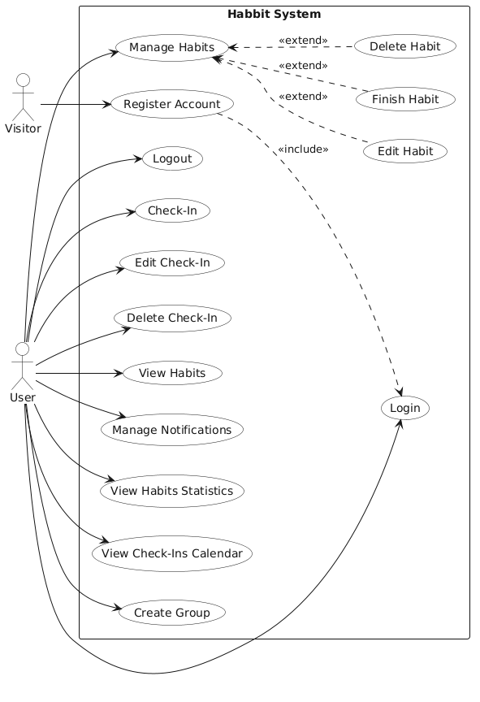
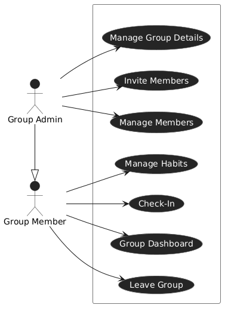
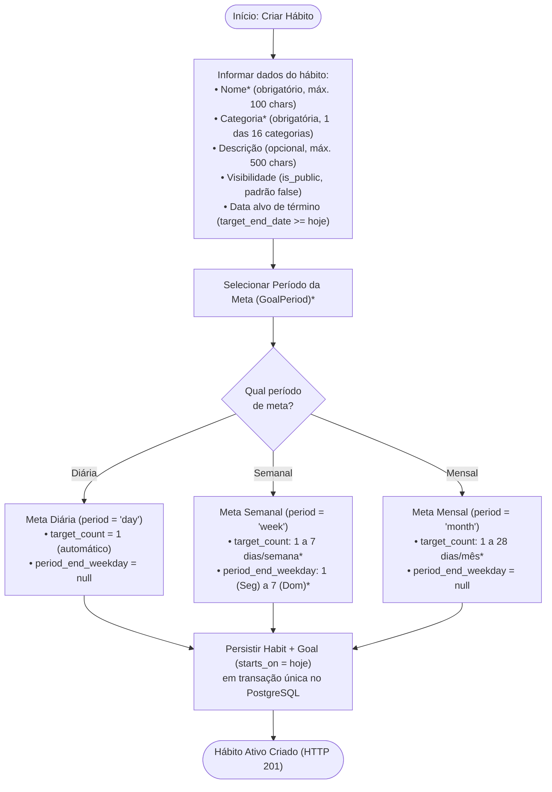
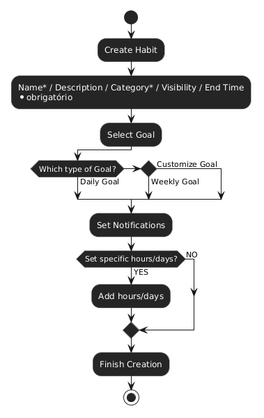
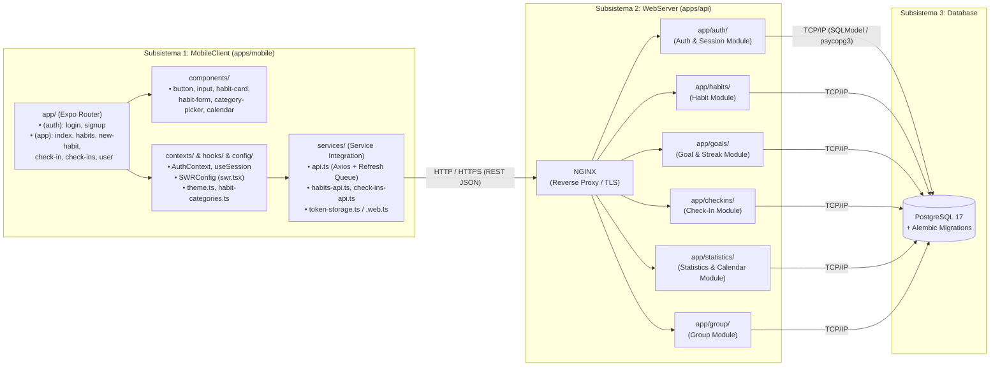
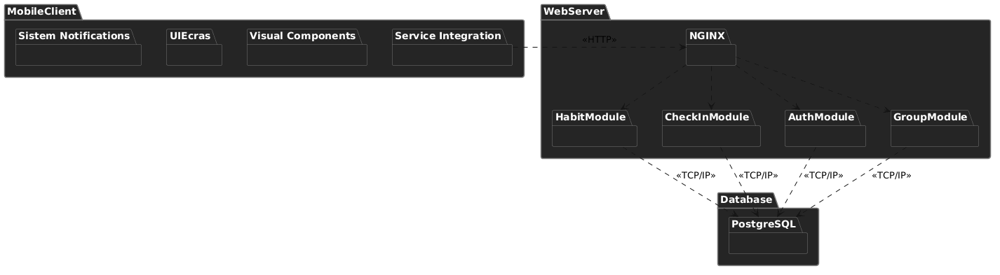

# Visão de Uso e Visão de Organização Lógica

Esta seção apresenta o comportamento externo do sistema **HABBIT** sob a perspectiva dos atores (**Visão de Uso**) e a decomposição interna em subsistemas, pacotes e camadas (**Visão de Organização Lógica**), atualizada na **Versão 3.0**.

---

## 1. Visão de Uso

### 1.1. Casos de Uso do Visitante e do Usuário Autenticado

O **Visitante** (ainda não autenticado) pode criar uma conta (*Register Account*), ação que já inclui a autenticação automática (*Login*), ou autenticar-se caso já possua conta. Uma vez autenticado, o **Usuário** pode encerrar sua sessão (*Logout*), gerenciar seus hábitos e metas (*Manage Habits*: criar, editar, definir meta diária/semanal/mensal, encerrar e excluir), visualizar hábitos com progresso (*View Habits*), registrar check-ins vinculados a múltiplos hábitos (*Check-In*), editar (*Edit Check-In*) e excluir (*Delete Check-In*) seus registros, consultar estatísticas consolidadas (*View Habits Statistics*) e o calendário mensal (*View Check-Ins Calendar*), configurar lembretes (*Manage Notifications*) e criar grupos (*Create Group*).

*Figura 02 – Diagrama de casos de uso do visitante e do usuário. Fonte: elaborado pelos autores (2026).*

---

### 1.2. Casos de Uso dos Grupos Compartilhados

Nos grupos de hábito, atuam dois perfis cumulativos:

- **Membro do Grupo (*Group Member*):** Registra check-ins no hábito compartilhado (*Check-In*), acompanha o progresso dos demais participantes e o ranking dos últimos 30 dias (*Group Dashboard*) e pode deixar o grupo (*Leave Group*).
- **Administrador do Grupo (*Group Admin*):** Especialização do Membro que herda todas as suas permissões e acrescenta a edição dos dados do grupo (*Manage Group Details*), o convite/adição de novos membros por *username* (*Invite Members*) e a remoção ou promoção de participantes (*Manage Members*).

*Figura 03 – Diagrama de casos de uso do grupo. Fonte: elaborado pelos autores (2026).*

---

### 1.3. Fluxo de Criação de Hábito e Definição de Meta (Versão 3.0)

A criação de um hábito é uma operação transacional que cria simultaneamente a entidade `Habit` e sua respectiva meta `Goal` (`POST /habits`). Na **Versão 3.0**, o fluxo suporta três períodos de meta (`day`, `week` e `month`):

*Figura 04 – Diagrama de atividades original da criação de hábito. Fonte: elaborado pelos autores (2026).*

---

## 2. Visão de Organização Lógica

O sistema **HABBIT** está organizado logicamente em três subsistemas principais — **`MobileClient` (Front-end)**, **`WebServer` (Back-end)** e **`Database` (Persistência)** — com fluxo de dependência estritamente unidirecional de fora para dentro.

*Figura 05 – Diagrama de pacotes original do sistema. Fonte: elaborado pelos autores (2026).*

---

### 2.1. Subsistema `MobileClient` (`apps/mobile/src/`)

Responsável pela interface gráfica, navegação, cache reativo e comunicação segura com a API:

- **`app/` (*UI & Telas via Expo Router*):** Organiza as telas por grupos de rotas:
  - `(auth)/login.tsx` e `(auth)/signup.tsx`: Fluxos públicos de entrada e cadastro;
  - `(app)/index.tsx`: Painel principal do usuário autenticado;
  - `(app)/habits.tsx`, `(app)/new-habit.tsx` e `(app)/habits/[id]`: Listagem com progresso, criação e gerenciamento detalhado de hábitos e metas;
  - `(app)/check-in.tsx` e `(app)/check-ins/[id]`: Fluxo guiado de check-in por categoria e tela de detalhe/edição/exclusão de check-in;
  - `(app)/user.tsx`: Tela de perfil e sessão do usuário consumindo dados via SWR.
- **`components/` (*Visual Components*):** Catálogo de componentes visuais isolados, testados com Jest e documentados no Storybook (`button`, `input`, `habit-card`, `habit-form`, `category-picker`, `calendar`).
- **`contexts/`, `hooks/` e `config/`:** Gerenciamento global de sessão (`AuthContext`), configuração global do **SWR** (`src/config/swr.tsx`), catálogo de categorias (`habit-categories.ts`) e tokens de design (`theme.ts`).
- **`services/` (*Service Integration*):** Camada única de rede baseada em **Axios** (`api.ts`), contendo interceptors automáticos que injetam o `Bearer access_token` e enfileiram requisições concorrentes durante a renovação transparente do `refresh_token` em caso de `HTTP 401`.

---

### 2.2. Subsistema `WebServer` (`apps/api/app/`)

Concentra todas as regras de negócio, segurança, cálculos algorítmicos e persistência:

- **`app/auth/` e `app/auth/session/` (`AuthModule`):** Cadastro de contas, hash de senhas com `bcrypt`, emissão de tokens JWT (`PyJWT`), controle de sessões ativas em `auth_sessions`, rotação atômica de JTI com detecção de reuso e dependência `get_current_user`.
- **`app/habits/` (`HabitModule`):** Criação, listagem (integrada ao progresso da meta), consulta com controle de visibilidade (`is_public`), edição parcial (`PATCH`), encerramento (`finish`) e exclusão definitiva (`DELETE`) de hábitos.
- **`app/goals/` (`GoalModule`):** Gestão da meta associada ao hábito (`PUT /goals/habits/{id}/goal`), validação de períodos (`day`, `week`, `month`) e execução do motor de progresso e streaks (`streak.py`).
- **`app/checkins/` (`CheckInModule`):** Registro transacional de check-ins vinculados a múltiplos hábitos (`1..20`), listagem de categorias elegíveis e opções paginadas de hábitos, histórico agrupado por dias no fuso de São Paulo, edição e exclusão.
- **`app/statistics/` (`StatisticsModule`):** Consolidação analítica do desempenho do usuário (`GET /user/statistics` nos modos `calendar` e `rolling`, com janela de 1 a 365 dias) e geração do calendário mensal por hábito (`GET /user/statistics/habits/{id}/calendar`).
- **`app/group/` (`GroupModule`):** Administração de grupos de hábitos compartilhados, membros e rankings de constância.

---

### 2.3. Subsistema `Database` (PostgreSQL 17 + Alembic)

Garante a integridade relacional e transacional (ACID) de todas as entidades por meio de chaves estrangeiras com políticas explícitas de `ON DELETE CASCADE`, índices de busca e restrições `CHECK` no próprio SGBD (`ck_habits_status_finished_at` e `ck_goals_period_rules`).
