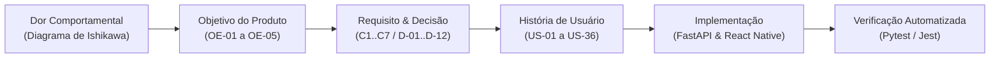

# Matriz de Rastreabilidade Bidirecional

A **Matriz de Rastreabilidade Bidirecional (*Forward & Backward Traceability*)** conecta cada dor identificada no **Diagrama de Ishikawa** aos **Objetivos do Produto**, **Cenários**, **Requisitos (`RF`/`RNF`)**, **Decisões de Produto (`D-01`–`D-12`)**, **Histórias de Usuário (`US-01`–`US-36`)**, **Endpoints da API FastAPI** e **Suítes de Teste Automatizadas**.

---

## 1. Fluxo de Rastreabilidade de Ponta a Ponta

---

## 2. Matriz Integrada de Rastreabilidade (Requisitos Funcionais)

| Dor Original (Ishikawa) | Objetivo | Requisito | Decisões | User Stories | Endpoints / Módulos Principais | Suítes de Teste Associadas |
| :--- | :---: | :---: | :---: | :---: | :--- | :--- |
| Necessidade de identidade individual e proteção de progresso | `OE-01` | **C1-RF-01** | — | `US-01` | `POST /auth/signup` `(auth)/signup.tsx` | `tests/auth/test_signup.py` `tests/auth/test_schemas.py` `auth-context.test.tsx` |
| Continuidade de uso no celular sem logins repetitivos | `OE-01` | **C1-RF-02** | — | `US-02`, `US-03` | `POST /auth/login` `POST /auth/refresh` `POST /auth/logout` `GET /auth/session/me` | `tests/auth/test_login.py` `tests/auth/test_refresh.py` `tests/auth/test_logout.py` `tests/auth/test_session.py` `api.test.ts` |
| Abandono de rotinas por falta de estruturação clara de objetivos | `OE-01` | **C2-RF-03** | `D-01`, `D-08` | `US-04` | `POST /habits` `(app)/new-habit.tsx` | `tests/habits/test_habits.py` `tests/goals/test_goal_create.py` |
| Dificuldade em manter, ajustar ou encerrar hábitos ao longo do tempo | `OE-01` | **C2-RF-04** | `D-11` | `US-05`, `US-06`, `US-07`, `US-35` | `GET /habits` `GET /habits/{id}` `PATCH /habits/{id}` `POST /habits/{id}/finish` `DELETE /habits/{id}` | `tests/habits/test_habits.py` `tests/goals/test_goal_list_and_check_in.py` `habits-check-ins-api.test.ts` |
| Rigidez de metas que não se adaptam à rotina diária, semanal ou mensal | `OE-02` | **C2-RF-05** | `D-01`, `D-12` | `US-08` | `PUT /goals/habits/{id}/goal` | `tests/goals/test_goal_create.py` `tests/goals/test_goal_update.py` |
| Fricção para registrar atividades cotidianas e tempo dedicado | `OE-01` | **C3-RF-06** **C7-RF-19** | `D-02`, `D-10` | `US-09`, `US-10`, `US-34`, `US-36` | `POST /check-ins` `GET /check-ins` `GET /check-ins/categories` `GET /check-ins/habit-options` `PATCH /check-ins/{id}` `DELETE /check-ins/{id}` | `tests/checkins/test_check_in_create.py` `tests/checkins/test_check_in_options.py` `tests/checkins/test_check_in_list.py` `check-in.test.tsx` `duration.test.ts` |
| Falta de motivação para manter o ritmo após os primeiros dias | `OE-02` | **C3-RF-07** **C3-RF-08** | `D-03`, `D-04` | `US-11`, `US-12`, `US-13`, `US-14` | `app/goals/streak.py` `GET /goals/habits/{id}/progress` | `tests/goals/unit/test_streak.py` `tests/goals/test_goal_progress.py` |
| Dificuldade em perceber o próprio progresso e risco de quebra de sequência | `OE-03` | **C4-RF-09** **C4-RF-10** | `D-03`, `D-04` | `US-15`, `US-16`, `US-17` | `GET /habits` `GET /user/statistics` `GET /user/statistics/habits/{id}/calendar` | `tests/statistics/unit/test_calculations.py` `tests/goals/unit/test_streak_statistics.py` `calendar.test.tsx` |
| Isolamento do indivíduo e ausência de suporte comunitário | `OE-05` | **C5-RF-11** **C5-RF-12** **C5-RF-13** | `D-05`, `D-06`, `D-09` | `US-18` a `US-24` | `app/group/` (Sprint 5) | Suíte de integração de grupos (Sprint 5) |
| Esquecimento da execução na rotina diária | `OE-04` | **C6-RF-14** | — | `US-25` | `Sistem Notifications` (Sprint 6) | Planejado para Sprint 6 |
| Acompanhamento da trajetória pessoal na conta | `OE-03` | **C7-RF-15** | — | `US-26`, `US-27` | `GET /auth/session/me` `(app)/user.tsx` | `user.test.tsx` `tests/auth/test_session.py` |

---

## 3. Rastreabilidade dos Requisitos Não Funcionais (RNFs)

| Código | Requisito Não Funcional | Meta / Critério Objetivo | Componente Responsável | Evidência de Verificação |
| :---: | :--- | :--- | :--- | :--- |
| **C1-RNF-01** | Segurança das credenciais | Hash **bcrypt** com *salt*, senha entre 8 chars e 72 bytes | `app/auth/security.py` | `tests/auth/test_security.py` |
| **C1-RNF-02** | Comunicação segura | HTTPS/TLS gerenciado na borda | NGINX Reverse Proxy | Topologia de implantação (`arquitetura/implantacao.md`) |
| **C1-RNF-03** | Controle de acesso e privacidade | `401` sem JWT, `403` fora de autoria, `404` em recursos privados de terceiros | `get_current_user`, `habits/service.py`, `checkins/service.py` | `tests/checkins/test_check_in_privacy.py`, `tests/habits/test_habits.py` |
| **C3-RNF-04** | Usabilidade do check-in | Registro rápido multi-hábito com retorno de `progress` na mesma requisição | `POST /check-ins` + `(app)/check-in.tsx` | `tests/goals/test_goal_list_and_check_in.py`, `check-in.test.tsx` |
| **C4-RNF-05** | Desempenho da API | P95 $\le 500\text{ ms}$ até 100 usuários simultâneos ($\approx 20\text{ req/s}$) | Consultas em lote (`list_check_in_days_for_habits`) | Cálculo em lote sem *N+1 queries* (`app/goals/service.py`) |
| **C4-RNF-06** | Portabilidade multiplataforma | Base única React Native + Expo para Android, iOS e Web | `apps/mobile` (`expo-router`, `token-storage.ts`/`.web.ts`) | `token-storage.test.ts` e workflow `mobile-tests.yaml` |
