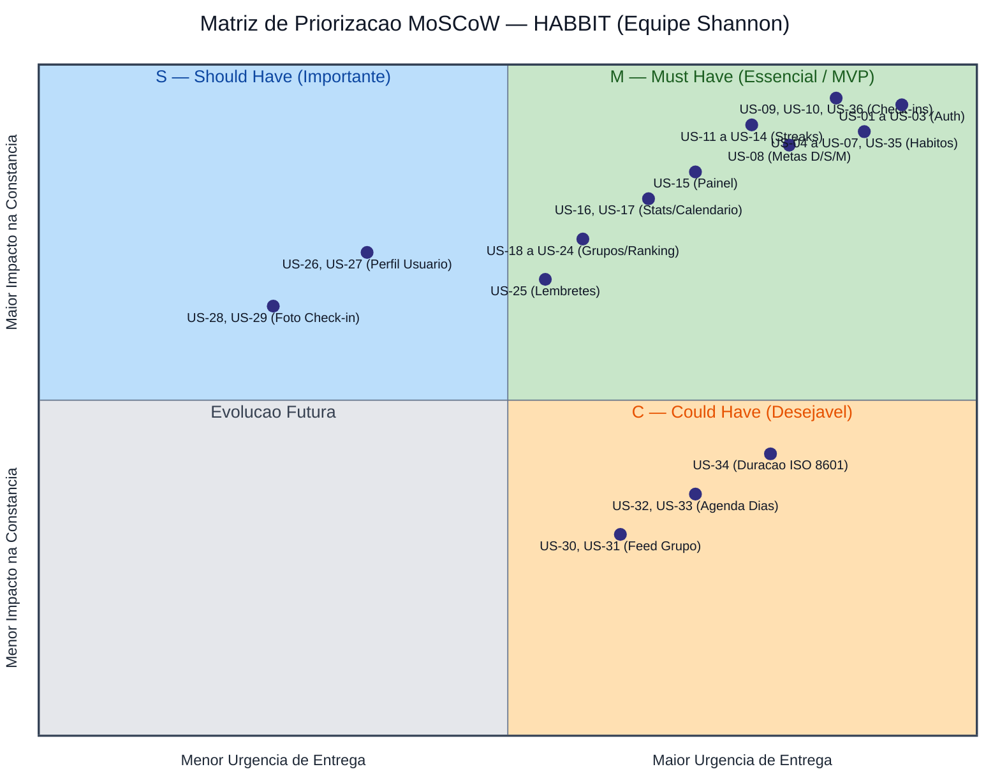

# Histórias de Usuários (US-01 a US-36)

As histórias de usuário do **HABBIT** seguem o formato canônico **"Como [perfil], quero [ação], para [benefício]"**, estão priorizadas pelo método **MoSCoW** (*Must, Should, Could*) e possuem critérios de aceite objetivos e verificáveis, atualizados na **Versão 3.0**.

---

## Gráfico de 4 Quadrantes — Priorização MoSCoW

---

## 1. Must Have — Essenciais para o MVP

### Cenário C1 — Acesso e Conta

| ID / Requisito | História de Usuário | Critérios de Aceite (Versão 3.0) | Status |
| :---: | :--- | :--- | :---: |
| **US-01** `C1-RF-01` `C1-RNF-01` | **Criar conta de usuário** Como **visitante**, quero criar uma conta com nome, *username*, e-mail e senha, para usar o aplicativo. | • Dados válidos criam a conta (`HTTP 201`), gravam a senha como *hash* bcrypt e já devolvem o usuário autenticado com `access_token` e `refresh_token`; • *Username* ou e-mail duplicado é recusado com `HTTP 409 Conflict` e mensagem específica em português; • Campo vazio, caracteres nulos (`\x00`), e-mail inválido ou senha fora da faixa (menos de 8 caracteres ou mais de 72 bytes) é recusado com `HTTP 422`; • *Username* e e-mail são normalizados para letras minúsculas e sem espaços nas extremidades. | **Concluído** |
| **US-02** `C1-RF-02` `C1-RNF-01` | **Autenticar e renovar sessão** Como **usuário**, quero entrar com *username* ou e-mail e senha, para acessar meus hábitos. | • Credenciais válidas em `POST /auth/login` retornam `HTTP 200` com `access_token` e `refresh_token` e registram a sessão em `auth_sessions`; • Credenciais inválidas retornam `HTTP 401` com mensagem genérica (`"Usuário ou senha inválidos."`); • Sessão ativa dispensa novo login, sendo renovada via `POST /auth/refresh` com rotação atômica do `current_jti`; • A apresentação de um *refresh token* já rotacionado (reuso) revoga imediatamente a sessão no banco e retorna `HTTP 401`. | **Concluído** |
| **US-03** `C1-RF-02` `C1-RNF-03` | **Encerrar sessão (Logout)** Como **usuário**, quero encerrar minha sessão, para proteger minha conta no dispositivo. | • `POST /auth/logout` remove a sessão correspondente ao `refresh_token` no servidor e retorna `HTTP 204 No Content`; • A operação é idempotente: encerrar uma sessão já encerrada ou inexistente também retorna `HTTP 204` sem erro; • No aplicativo móvel, os tokens locais são limpos e rotas protegidas redirecionam para a tela de login. | **Concluído** |

---

### Cenário C2 — Gestão de Hábitos e Metas

| ID / Requisito | História de Usuário | Critérios de Aceite (Versão 3.0) | Status |
| :---: | :--- | :--- | :---: |
| **US-04** `C2-RF-03` `D-01`, `D-08` | **Criar hábito com meta inicial** Como **usuário**, quero criar um hábito com nome, descrição, categoria, visibilidade, data de término e meta, para começar a acompanhá-lo. | • `name`, `category` e `goal` são obrigatórios no `POST /habits` (`HTTP 201`); • `category` deve pertencer ao catálogo predefinido de 16 categorias (`D-08`); • Sem visibilidade informada, nasce privado (`is_public = false`); • `target_end_date` anterior à data de criação (hoje no fuso `America/Sao_Paulo`) é recusada com `HTTP 422`. | **Concluído** |
| **US-05** `C2-RF-04` `C4-RF-09` | **Listar hábitos do usuário com progresso** Como **usuário**, quero ver meus hábitos ativos, para escolher qual acompanhar. | • `GET /habits` lista os hábitos do usuário ordenados por `created_at` decrescente e `name` crescente; • Suporta filtro opcional por `?status=active` ou `?status=finished`; • Cada item retorna o esquema `HabitWithProgress`, contendo os dados do hábito, a meta (`goal`) e o progresso calculado em tempo real (`progress`). | **Concluído** |
| **US-06** `C2-RF-04` | **Editar informações do hábito** Como **autor**, quero editar as informações do hábito, para mantê-las atualizadas. | • `PATCH /habits/{id}` altera apenas os campos enviados (`name`, `description`, `category`, `is_public`, `target_end_date`), preservando os check-ins; • Enviar `description: null` ou `target_end_date: null` limpa o valor; `name`, `category` e `is_public` não aceitam `null`; • Quem não é autor do hábito recebe `HTTP 403` (se público) ou `HTTP 404` (se privado). | **Concluído** |
| **US-07** `C2-RF-04` `D-11` | **Encerrar hábito preservando histórico** Como **autor**, quero encerrar um hábito, para parar de acompanhá-lo sem perder o histórico. | • `POST /habits/{id}/finish` altera `status` para `finished` e grava `finished_at` com a data de hoje; • Hábito já encerrado retorna `HTTP 409 Conflict`; • Hábito encerrado preserva todos os check-ins e vínculos, exibe `progress.status = "ended"`, mas não aceita novos check-ins nem alteração de meta. | **Concluído** |
| **US-35** `C2-RF-04` `D-11` | **Excluir hábito definitivamente** Como **autor**, quero excluir um hábito definitivamente, para remover um hábito criado por engano ou que não quero mais manter. | • `DELETE /habits/{id}` responde `HTTP 204 No Content`; apenas o autor pode excluir; • Remove o hábito, sua meta (`goals`) e seus vínculos em `check_in_habits`; • Os registros em `check_ins` permanecem salvos no histórico de atividades do usuário (`D-11`). | **Concluído** |
| **US-08** `C2-RF-05` `D-01`, `D-12` | **Definir ou alterar meta do hábito** Como **autor**, quero definir o período e a meta de cumprimento de um hábito, para acompanhar minha constância por metas. | • `PUT /goals/habits/{id}/goal` cria ou substitui a meta de um hábito ativo; • Suporta 3 períodos (`GoalPeriod`): `day` (`target_count = 1`), `week` (`target_count` de 1 a 7 e `period_end_weekday` obrigatório de 1 a 7) e `month` (`target_count` de 1 a 28); • `period_end_weekday` em meta diária ou mensal é recusado com `HTTP 422`; • Alterar `period`, `target_count` ou `period_end_weekday` redefine `starts_on` para hoje e reinicia o streak (`D-12`); enviar a mesma meta não altera `starts_on`; • Hábito encerrado recusa alteração de meta com `HTTP 409`. | **Concluído** |

---

### Cenário C3 — Registro e Constância

| ID / Requisito | História de Usuário | Critérios de Aceite (Versão 3.0) | Status |
| :---: | :--- | :--- | :---: |
| **US-09** `C3-RF-06` `D-02`, `D-10` | **Registrar check-in vinculado a um ou mais hábitos** Como **usuário**, quero registrar um check-in sempre que cumprir um ou mais hábitos, vinculando-o a eles, para acompanhar meu progresso. | • `POST /check-ins` exige `title` (1 a 150 caracteres) e `habit_ids` (de 1 a 20 UUIDs únicos de hábitos ativos do autor); `description` (até 500 caracteres) e `duration` são opcionais; • Auxiliado pelas rotas `GET /check-ins/categories` e `GET /check-ins/habit-options` para seleção em etapas no app; • Se algum hábito não existir (`404`), pertencer a outro usuário (`403`) ou estiver encerrado (`409`), nada é gravado e a resposta informa o erro mais grave e os `habit_ids` recusados; • O sucesso (`HTTP 201`) retorna o check-in criado e a lista `progress` com o `GoalProgress` atualizado de cada hábito vinculado. | **Concluído** |
| **US-10** `C3-RF-06` `D-02` | **Excluir check-in** Como **usuário**, quero excluir um check-in meu, para corrigir um registro errado. | • `DELETE /check-ins/{id}` permite ao autor excluir qualquer check-in seu, de qualquer data (inclusive vinculado a hábito já encerrado), respondendo `HTTP 204`; • Remove o check-in e seus vínculos em `check_in_habits`; • Na consulta seguinte, o progresso e os streaks dos hábitos vinculados são recalculados automaticamente sem aquele registro; • Quem não é autor recebe `HTTP 403` (ou `404` se não tiver visibilidade). | **Concluído** |
| **US-36** `C3-RF-06` `D-02`, `D-10` | **Editar check-in** Como **usuário**, quero editar um check-in meu, para corrigir ou complementar o que registrei. | • `PATCH /check-ins/{id}` permite ao autor alterar `title`, `description` e `duration` de qualquer check-in seu; • `description` vazia/nula ou `duration` nula apagam o respectivo valor; `title` nulo ou vazio é recusado com `HTTP 422`; • Quem não é autor do check-in não pode editá-lo (`HTTP 403` / `404`). | **Concluído** |
| **US-11** `C3-RF-07` `D-03`, `D-04` | **Acompanhar streak atual do hábito** Como **usuário**, quero ver há quantos períodos seguidos cumpro a meta de um hábito, para não quebrar a sequência. | • `current_streak` conta os períodos consecutivos cumpridos (`done >= target_count`) a partir de `starts_on`; • O período atual soma `+1` assim que a meta é atingida, mas enquanto estiver em aberto e incompleto não zera a sequência conquistada até o período anterior; • `consistent_days` informa quantos dias corridos transcorreram desde o primeiro check-in da sequência atual. | **Concluído** |
| **US-12** `C3-RF-07` `D-03` | **Visualizar maior sequência (recorde) no hábito** Como **usuário**, quero ver minha maior sequência no hábito, para saber meu melhor desempenho. | • `best_streak` retorna a maior sequência histórica de períodos consecutivos cumpridos desde o `starts_on` da meta; • Quando o `current_streak` alcança ou supera o recorde anterior, `best_streak` e `current_streak` assumem o mesmo valor. | **Concluído** |
| **US-13** `C3-RF-07` `D-03` | **Visualizar sequência geral de atividade do usuário** Como **usuário**, quero ver há quantos dias seguidos realizo check-ins no aplicativo, para manter constância geral. | • `activity_streak` (em `GET /user/statistics`) calcula `current` (dias consecutivos com ao menos 1 check-in até hoje ou ontem no fuso `America/Sao_Paulo`) e `best` (maior sequência histórica de dias ativos do usuário). | **Concluído** |
| **US-14** `C3-RF-08` `D-01`, `D-04` | **Acompanhar metas semanais e mensais** Como **usuário**, quero ver há quantas semanas ou meses seguidos cumpro a meta periódica do hábito, para acompanhar minha constância sem depender de todos os dias. | • Na meta semanal (`week`), cada janela de 7 dias fecha no `period_end_weekday` escolhido pelo autor; • Na meta mensal (`month`), cada janela compreende do dia 1 ao último dia do mês; • O período atual informa `start`, `end`, `done`, `target_count` e `status` (`completed`, `in_progress`, `at_risk`, `failed` ou `ended`). | **Concluído** |

---

### Cenário C4 — Acompanhamento do Progresso

| ID / Requisito | História de Usuário | Critérios de Aceite (Versão 3.0) | Status |
| :---: | :--- | :--- | :---: |
| **US-15** `C4-RF-09` `D-04` | **Visualizar hábitos com progresso e status atual** Como **usuário**, quero ver na listagem e na tela de acompanhamento meus hábitos com o progresso atual, para saber o que falta fazer. | • `GET /habits` e `GET /goals/habits/{id}/progress` retornam o progresso completo do período (`done` de `target_count`), `current_streak`, `best_streak`, `consistent_days` e `status`; • No aplicativo móvel, os dados são mantidos sincronizados via cache reativo com **SWR**. | **Concluído** |
| **US-16** `C4-RF-10` | **Visualizar calendário mensal do hábito** Como **usuário**, quero ver um calendário mensal dos dias cumpridos de um hábito, para enxergar minha constância. | • `GET /user/statistics/habits/{id}/calendar?month=YYYY-MM` retorna todos os dias do mês com seu estado (`CalendarDayState`):   - `completed`: dia com check-in em período que atingiu a meta;   - `partial`: dia com check-in em período que ainda não atingiu (ou falhou) a meta (aplicável a metas `week` e `month`);   - `none`: dentro da vigência da meta/hábito, mas sem check-in;   - `outside`: antes de `starts_on`, após `finished_at` ou após a data de hoje. | **Concluído** |
| **US-17** `C4-RF-10` | **Visualizar estatísticas e gráficos de evolução** Como **usuário**, quero ver estatísticas consolidadas e séries de check-ins ao longo do tempo, para avaliar minha evolução. | • `GET /user/statistics` aceita `mode` (`calendar` ou `rolling`) e `days` (`1` a `365`, padrão `30`); • Retorna contagens de hábitos (`total`, `active`, `finished`), check-ins (`total`, `today`, `week`, `month`), hábitos concluídos (`today`, `week`, `month`), taxa global de cumprimento de metas (`goal_completion`), `activity_streak`, hábitos `at_risk`, lista `habit_progress` com taxa de constância individual e a `series` diária de pontos (`date`, `count`). | **Concluído** |

---

### Cenários C5 e C6 — Hábitos em Grupo e Lembretes

| ID / Requisito | História de Usuário | Critérios de Aceite (Versão 3.0) | Status |
| :---: | :--- | :--- | :---: |
| **US-18** `C5-RF-11` `D-05` | **Criar grupo em torno de um hábito** Como **usuário**, quero criar um grupo em torno de um hábito, para cumpri-lo com outras pessoas. | • Nome e hábito ativo de autoria do usuário criam o grupo e tornam o criador Membro e Admin; • Hábito de outro autor ou já vinculado a um grupo é recusado; • As metas do hábito valem para todos os membros; descrição é opcional. | **Em andamento (Sprint 5)** |
| **US-19** `C5-RF-12` `D-09` | **Adicionar membros pelo username** Como **admin**, quero adicionar pessoas pelo *username*, para que acompanhem o hábito comigo. | • *Username* existente vira Membro e recebe o hábito compartilhado; • *Username* inexistente exibe erro (`HTTP 404`); membro já participante não é duplicado (`HTTP 409`); • Membro sem perfil de Admin recebe `HTTP 403`. | **Em andamento (Sprint 5)** |
| **US-20** `C5-RF-11` | **Remover membros e promover administradores** Como **admin**, quero remover membros e promover outros a admin, para manter o grupo organizado. | • Membro removido perde acesso ao grupo, mantendo seus check-ins individuais; • A promoção torna o membro Admin (`is_admin = true`); • O único Admin do grupo não pode ser removido sem antes promover outro membro. | **Em andamento (Sprint 5)** |
| **US-21** `C5-RF-12` | **Sair de um grupo** Como **membro**, quero sair de um grupo, para deixar de acompanhar o hábito compartilhado. | • Membro comum sai do grupo e o hábito compartilhado deixa sua lista; • Único Admin com outros membros precisa promover alguém antes de sair. | **Em andamento (Sprint 5)** |
| **US-22** `C5-RF-12` | **Acompanhar progresso dos membros do grupo** Como **membro**, quero ver o progresso dos membros no hábito do grupo, para me manter motivado. | • Exibe cada membro com o progresso do período atual e seu streak no hábito compartilhado; • Quem não é membro do grupo não tem acesso (`HTTP 403` / `404`). | **Em andamento (Sprint 5)** |
| **US-23** `C5-RF-13` `D-06` | **Visualizar ranking do grupo** Como **membro**, quero ver o ranking do grupo por quantidade de check-ins, para comparar meu desempenho com o dos outros. | • Ordena os membros pelos check-ins válidos no hábito do grupo nos últimos 30 dias; • Empates ocupam a mesma posição; grupo sem check-ins exibe todos com zero. | **Em andamento (Sprint 5)** |
| **US-24** `C5-RF-11` | **Editar nome e descrição do grupo** Como **admin**, quero editar nome e descrição do grupo, para mantê-los atualizados. | • Admin altera nome e descrição; nome vazio é recusado com `HTTP 422`; • Membro sem perfil de Admin recebe `HTTP 403`. | **Em andamento (Sprint 5)** |
| **US-25** `C6-RF-14` | **Receber lembretes de hábito pendente** Como **usuário**, quero receber uma notificação enquanto a meta estiver pendente, para não esquecer de cumprir o hábito. | • Horário configurado gera notificação local enquanto a meta do período não for atingida; • Cumprir a meta antes do horário suspende a notificação do período; sem permissão do SO, o aplicativo orienta o usuário. | **Planejado (Sprint 6)** |

---

## 2. Should Have — Importantes

| ID / Requisito | História de Usuário | Critérios de Aceite (Versão 3.0) | Status |
| :---: | :--- | :--- | :---: |
| **US-26** `C7-RF-15` | **Editar dados da conta e privacidade** Como **usuário**, quero editar meus dados cadastrais e a visibilidade das minhas estatísticas, para manter minha conta atualizada. | • Dados válidos são gravados; *username* ou e-mail já pertencente a outra conta é recusado com `HTTP 409`; • A tabela `users` possui a flag `statistics_is_public` (`BOOLEAN`, padrão `false`). | **Parcialmente concluído** |
| **US-27** `C7-RF-15` | **Visualizar resumo do perfil do usuário** Como **usuário**, quero ver minhas informações de perfil e resumo de trajetória, para acompanhar meu desempenho geral. | • Tela de usuário (`src/app/(app)/user.tsx`) consome `/auth/session/me` via SWR, exibe dados do perfil, permite atualização cadastral e encerramento seguro da sessão; estatísticas gerais são providas por `/user/statistics`. | **Concluído** |
| **US-28** `C7-RF-16` `C7-RNF-07` | **Anexar foto a um check-in** Como **usuário**, quero anexar uma foto a um check-in, para guardar uma evidência do que fiz. | • Arquivo JPEG ou PNG de até 5 MB armazenado em *bucket* e vinculado ao check-in; • Visível apenas ao autor (hábito privado) ou membros do grupo. | **Planejado (Sprint 6)** |
| **US-29** `C7-RF-16` | **Substituir ou remover foto de um check-in de hoje** Como **usuário**, quero substituir ou remover a foto de um check-in de hoje, para corrigir um envio errado. | • Substituir ou remover apaga a foto anterior do armazenamento; • Check-ins de datas anteriores não permitem troca da foto. | **Planejado (Sprint 6)** |

---

## 3. Could Have — Desejáveis

| ID / Requisito | História de Usuário | Critérios de Aceite (Versão 3.0) | Status |
| :---: | :--- | :--- | :---: |
| **US-34** `C7-RF-19` `D-10` | **Informar duração dedicada ao check-in** Como **usuário**, quero informar quanto tempo dediquei a cada check-in, para acompanhar o tempo investido. | • Aceita duração positiva no formato **ISO 8601** (ex.: `PT30M`, `PT1H`, `PT1H30M`) no `POST /check-ins` e `PATCH /check-ins/{id}`; • Persistida como `INTERVAL` no PostgreSQL e formatada no Front-end (`src/utils/duration.ts`); • Duração zero, negativa ou fora do padrão ISO 8601 é recusada com `HTTP 422`. | **Concluído (Antecipado na Sprint 2/3)** |
| **US-30** `C7-RF-17` `D-07` | **Visualizar feed de metas cumpridas nos grupos** Como **usuário**, quero ver quando os membros dos meus grupos cumprem a meta, para acompanhar a comunidade. | • Exibe uma entrada por membro quando ele atinge a meta do hábito do grupo, ordenada da mais recente à mais antiga. | **Planejado (Sprint 7)** |
| **US-31** `C7-RF-17` | **Filtrar feed de atividades por grupo** Como **usuário**, quero filtrar o feed por grupo, para ver apenas o que me interessa. | • Selecionar um grupo filtra as entradas; remover o filtro restaura a visualização de todos os grupos do usuário. | **Planejado (Sprint 7)** |
| **US-32** `C7-RF-18` | **Escolher dias específicos da semana para o hábito** Como **autor**, quero escolher os dias da semana do hábito, para refletir minha rotina real. | • Evolução do campo `schedule_type` da tabela `goals` (preparado como `VARCHAR(20)` sem `ENUM` nativo no banco para facilitar migração via Alembic). | **Planejado (Sprint 7)** |
| **US-33** `C7-RF-18` | **Preservar streak em dias fora da agenda semanal** Como **usuário**, quero que os dias não agendados não quebrem meu streak, para que a contagem reflita minha rotina. | • Dias fora da agenda não interrompem a sequência nem aparecem como pendentes. | **Planejado (Sprint 7)** |
