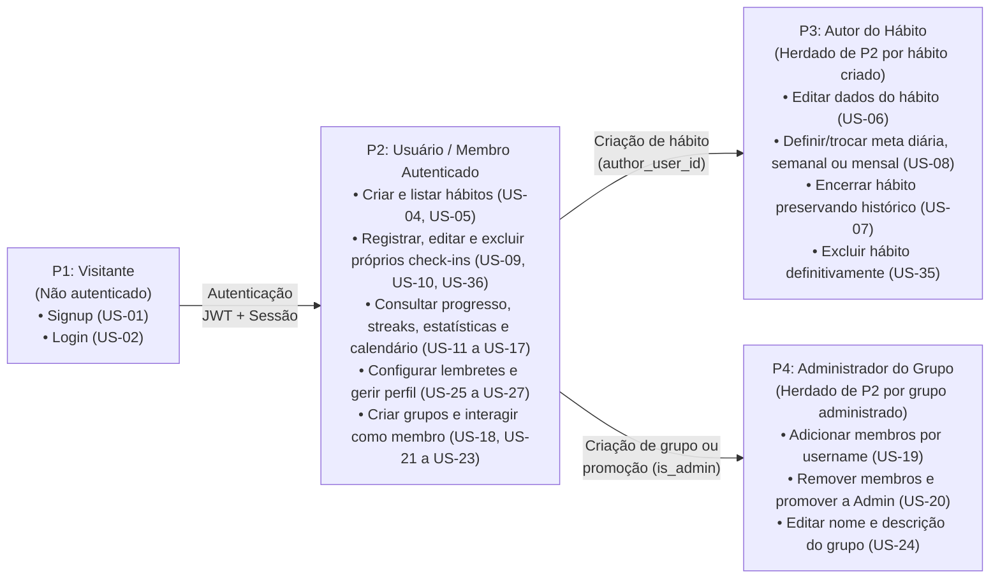

# Perfis de Acesso, Elicitação e Cenários Funcionais

Esta seção documenta o processo de elicitação de requisitos do **HABBIT**, os critérios da classificação **MoSCoW**, a hierarquia cumulativa de perfis de acesso (`P1` a `P4`) e a divisão do sistema em sete cenários funcionais (`C1` a `C7`).

---

## 1. Técnicas de Elicitação de Requisitos

Os requisitos funcionais e não funcionais do **HABBIT** foram obtidos por meio de três técnicas complementares de engenharia de requisitos:

### Quadro 10 — Técnicas de Elicitação, Aplicação e Requisitos Originados

| Técnica | Aplicação no Projeto | Principais Requisitos Originados | Perfis Envolvidos |
| :--- | :--- | :--- | :--- |
| **Questionário com o Público-Alvo** | Aplicado pela equipe a jovens adultos (18 a 30 anos). Levantou as três dores principais — falta de motivação, falta de companhia e dificuldade de perceber o próprio progresso — além das formas preferidas de medição e visualização. | Motor de metas e streaks, módulo de estatísticas, calendário mensal, grupos compartilhados e lembretes. | `P2` Usuário Autenticado |
| **Análise de Concorrentes** | Estudo comparativo de *Gymrats*, *YPT* e *Habitica*, que orientou o posicionamento do produto e a decisão de não restringir o aplicativo a um único nicho. | Catálogo predefinido de 16 categorias de hábito, registro opcional de duração ISO 8601, grupos e ranking de 30 dias. | `P2` Usuário Autenticado, `P4` Administrador do Grupo |
| **Brainstorming da Equipe** | Reuniões técnicas de definição do modelo relacional, regras de fuso horário, sessões JWT e fronteiras de autorização. | Estrutura de hábitos e metas (`day`, `week`, `month`), check-ins multi-hábito (N:N), rotação de *refresh token* e perfis de acesso. | `P1`, `P2`, `P3` e `P4` |

---

## 2. Classificação de Prioridade (MoSCoW)

### Quadro 11 — Classes de Prioridade MoSCoW no HABBIT

| Classe | Significado Operacional no Projeto |
| :---: | :--- |
| **Must** | Requisito **essencial** sem o qual o produto não cumpre seus objetivos centrais (compõe o MVP): autenticação segura, gestão de hábitos, metas periódicas (`day`, `week`, `month`), check-ins, cálculo de streaks, painel/estatísticas, calendário mensal, grupos com ranking e lembretes. |
| **Should** | Requisito **importante** que agrega valor relevante à experiência, mas cuja ausência temporária não impede a operação do núcleo do produto: edição e resumo de perfil do usuário e anexo de fotos nos check-ins. |
| **Could** | Requisito **desejável**, implementado conforme a disponibilidade de cronograma ou antecipado estrategicamente: medição de duração do check-in em ISO 8601 (antecipada e já entregue na Sprint 2/3), feed de atividades do grupo e agendamento por dias fixos da semana. |

---

## 3. Perfis de Acesso (RBAC Cumulativo)

Os perfis de acesso do **HABBIT** são **cumulativos**: um mesmo usuário autenticado (`P2`) atua simultaneamente como **Autor (`P3`)** nos hábitos que criou e como **Membro (`P2`)** ou **Administrador (`P4`)** nos grupos de que participa.

### Quadro 12 — Especificação dos Perfis de Acesso

| # | Nome do Perfil | Características do Perfil | Permissões de Acesso |
| :---: | :--- | :--- | :--- |
| **P1** | **Visitante** | Usuário que instalou o aplicativo móvel ou acessou via web, mas ainda não possui sessão ativa. | Acesso restrito às rotas públicas de Cadastro (`POST /auth/signup`, `US-01`), Login (`POST /auth/login`, `US-02`) e Renovação (`POST /auth/refresh`). Não visualiza nem manipula hábitos ou check-ins. |
| **P2** | **Usuário / Membro Autenticado** | Usuário regular com conta ativa e token de acesso válido. | Criar e listar hábitos com progresso (`US-04`, `US-05`); registrar, editar e excluir seus próprios check-ins (`US-09`, `US-10`, `US-34`, `US-36`, `US-28`, `US-29`); consultar acompanhamento, streaks, estatísticas e calendário (`US-11` a `US-17`); configurar lembretes (`US-25`); gerir o próprio perfil (`US-26`, `US-27`); criar grupos (`US-18`); e, como membro, visualizar progresso do grupo, ranking e sair dele (`US-21` a `US-23`, `US-30`, `US-31`). |
| **P3** | **Autor do Hábito** | Usuário criador de um hábito individual ou compartilhado (`habit.author_user_id == user.id`). | Todas as permissões de `P2`, somadas ao poder exclusivo de editar o hábito (`PATCH /habits/{id}`, `US-06`), definir ou alterar sua meta (`PUT /goals/habits/{id}/goal`, `US-08`), encerrar o hábito (`POST /habits/{id}/finish`, `US-07`) e excluí-lo definitivamente (`DELETE /habits/{id}`, `US-35`). |
| **P4** | **Administrador do Grupo** | Criador do grupo compartilhado ou membro promovido a administrador (`member.is_admin == true`). | Todas as permissões de Membro do grupo, somadas a adicionar novos participantes pelo *username* (`US-19`), remover participantes (`US-20`), promover outros membros a administradores (`US-20`) e editar nome e descrição do grupo (`US-24`). |

---

## 4. Cenários Funcionais do Sistema

Os requisitos e histórias de usuário do **HABBIT** são agrupados em sete cenários funcionais coesos (`C1` a `C7`):

### Quadro 13 — Cenários Funcionais e Alocação por Sprints

| Código | Nome do Cenário Funcional | Escopo Resumido | Sprints Alocadas (BE / FE) | Status na v3.0 |
| :---: | :--- | :--- | :---: | :---: |
| **C1** | **Acesso e Conta** | Cadastro, login por *username* ou e-mail, sessões persistidas em banco com rotação de *refresh token*, consulta do usuário logado (`/auth/session/me`) e logout idempotente. | Sprints 1 e 2 | **Concluído (100%)** |
| **C2** | **Gestão de Hábitos e Metas** | Criação, listagem com progresso, consulta por ID (respeitando visibilidade pública/privada), edição parcial, encerramento, exclusão definitiva e configuração de metas (`day`, `week`, `month`). | Sprints 2, 3 e 4 | **Concluído (100%)** |
| **C3** | **Registro e Constância** | Registro de check-in multi-hábito (1 a 20 hábitos) com título, descrição e duração ISO 8601, listagem por categorias e opções paginadas, histórico agrupado por dias, edição/exclusão e motor de streaks. | Sprints 2, 3 e 4 | **Concluído (100%)** |
| **C4** | **Acompanhamento do Progresso** | Painel diário de hábitos, estatísticas gerais do usuário (modos `calendar` e `rolling`, série diária, taxa de conclusão, hábitos em risco e sequência de atividade) e calendário mensal por hábito. | Sprints 4 e 5 | **Concluído no BE / Em integração final no FE** |
| **C5** | **Hábitos em Grupo** | Criação de grupos vinculados a hábitos compartilhados, gestão de membros e administradores, painel coletivo e ranking dos últimos 30 dias. | Sprints 5 e 6 | **Em desenvolvimento (Sprint 5)** |
| **C6** | **Engajamento e Lembretes** | Agendamento e disparo de notificações locais enquanto a meta do período permanecer pendente. | Sprints 6 e 7 | **Planejado (Sprint 6)** |
| **C7** | **Comunidade e Personalização** | Duração do check-in (`C7-RF-19`, **já entregue**), tela e privacidade de estatísticas do usuário, anexo de fotos em storage bucket e feed de atividades. | Sprints 2, 4, 6 e 7 | **Parcialmente concluído** |
