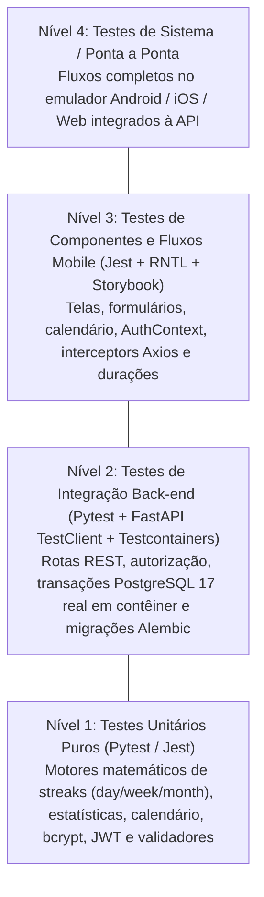

# Estratégia e Roteiro de Testes de Software

Esta seção detalha a estratégia de verificação e validação do **HABBIT**, os ambientes de teste automatizado e o mapeamento entre os casos de teste planejados e as suítes efetivamente implementadas em `apps/api/tests/` e `apps/mobile/src/__tests__/`.

---

## 1. Estratégia e Níveis de Teste

A pirâmide de testes do **HABBIT** estrutura-se em quatro níveis complementares:

| Nível | Escopo Verificado | Ferramental Adotado |
| :--- | :--- | :--- |
| **1. Unitário** | Funções matemáticas e utilitárias isoladas de banco e rede: cálculo de progresso e streaks (`day`, `week`, `month`), taxas de cumprimento, séries e calendário mensal, hashing de senhas com `bcrypt`, emissão/decodificação de JWT, validadores Pydantic e formatação de durações ISO 8601. | **Pytest** (`apps/api/tests/goals/unit/`, `apps/api/tests/statistics/unit/`, `apps/api/tests/auth/`) e **Jest** (`apps/mobile/src/__tests__/utils/`) |
| **2. Integração** | Comunicação completa entre rotas FastAPI (`TestClient`), injeção de dependências (`SessionDep`, `get_current_user`), regras de negócio nos `services` e persistência real no **PostgreSQL 17** provisionado automaticamente em contêiner via **Testcontainers**, além da verificação de migrações **Alembic** (`test_migrations.py`). | **Pytest** + **FastAPI TestClient** + **Testcontainers (`postgres:17`)** |
| **3. Componente / Interface** | Renderização, estados visuais, interações de toque, armazenamento de tokens (`expo-secure-store` / `localStorage`), fila de refresh no Axios e fluxos em etapas (como o check-in guiado por categorias) no React Native, além da documentação visual isolada no **Storybook**. | **Jest (`jest-expo`)** + **React Native Testing Library** + **Storybook React Native** |
| **4. Sistema** | Execução ponta a ponta dos fluxos das User Stories e verificação dos Requisitos Não Funcionais (como usabilidade do check-in em até dois toques `C3-RNF-04`). | Aplicativo Expo em emulador/dispositivo integrado à API e banco PostgreSQL |

---

## 2. Mapeamento das Suítes de Teste no Repositório

### 2.1. Suítes Back-end (`apps/api/tests/`)

| Caminho do Arquivo de Teste | Domínio / Funcionalidade Coberta | Tipo |
| :--- | :--- | :---: |
| `tests/test_migrations.py` | Validação de `upgrade` e `downgrade` das migrações **Alembic** no PostgreSQL 17. | Integração |
| `tests/auth/test_security.py` | Hash e verificação de senhas com `bcrypt` e limite de 72 bytes (`C1-RNF-01`). | Unitário |
| `tests/auth/test_tokens.py` | Geração, expiração e validação de `access_token` e `refresh_token` (`PyJWT`). | Unitário |
| `tests/auth/test_schemas.py` | Normalização de e-mail/*username* e rejeição de caracteres nulos (`\x00`). | Unitário |
| `tests/auth/test_signup.py` | Cadastro de usuário (`POST /auth/signup`), duplicidade (`409`) e login imediato (`US-01`). | Integração |
| `tests/auth/test_login.py` | Login por *username* ou e-mail (`POST /auth/login`) e recusa de credenciais inválidas (`US-02`). | Integração |
| `tests/auth/test_refresh.py` | Rotação atômica de `current_jti` (`POST /auth/refresh`) e revogação por reuso (`US-02`). | Integração |
| `tests/auth/test_logout.py` | Encerramento idempotente de sessão (`POST /auth/logout`, `US-03`). | Integração |
| `tests/auth/test_session.py` | Consulta do usuário autenticado (`GET /auth/session/me`) e bloqueio sem JWT (`401`). | Integração |
| `tests/habits/test_habits.py` | Criação, listagem, consulta por ID, edição (`PATCH`), encerramento (`finish`) e exclusão (`DELETE`) de hábitos (`US-04` a `US-07`, `US-35`). | Integração |
| `tests/goals/unit/test_streak.py` | Motor de períodos (`day`, `week`, `month`), `ProgressStatus`, `current_streak`, `best_streak` e `consistent_days` (`US-11`, `US-12`, `US-14`). | Unitário |
| `tests/goals/unit/test_streak_statistics.py` | Funções `completion_dates` e `period_results` para janelas estatísticas. | Unitário |
| `tests/goals/test_goal_create.py` | Criação de hábitos com metas diária, semanal e mensal e regras `ck_goals_period_rules` (`US-08`). | Integração |
| `tests/goals/test_goal_update.py` | Troca de meta (`PUT /goals/habits/{id}/goal`), idempotência e reinício de `starts_on` (`D-12`). | Integração |
| `tests/goals/test_goal_progress.py` | Consulta de acompanhamento (`GET /goals/habits/{id}/progress`, `US-15`). | Integração |
| `tests/goals/test_goal_list_and_check_in.py` | Retorno de `HabitWithProgress` em `GET /habits` e de `progress` em `POST /check-ins`. | Integração |
| `tests/checkins/test_check_in_create.py` | Criação de check-in multi-hábito, duração ISO 8601, edição e exclusão (`US-09`, `US-10`, `US-34`, `US-36`). | Integração |
| `tests/checkins/test_check_in_options.py` | Rotas `GET /check-ins/categories` e `GET /check-ins/habit-options`. | Integração |
| `tests/checkins/test_check_in_list.py` | Listagem de check-ins agrupados por dias no fuso `America/Sao_Paulo` (`GET /check-ins`). | Integração |
| `tests/checkins/test_check_in_privacy.py` | Controle de visibilidade e recusa de acesso a hábitos/check-ins privados de terceiros (`C1-RNF-03`). | Integração |
| `tests/statistics/unit/test_calculations.py` | Cálculos de `UserStatistics` (`calendar` vs. `rolling`), `activity_streak`, `at_risk`, séries e calendário mensal (`US-13`, `US-16`, `US-17`). | Unitário |

---

### 2.2. Suítes Front-end (`apps/mobile/src/__tests__/`)

| Caminho do Arquivo de Teste | Domínio / Funcionalidade Coberta | Tipo |
| :--- | :--- | :---: |
| `src/__tests__/contexts/auth-context.test.tsx` | Ciclo de vida de autenticação, hidratação de sessão, login, signup e logout no `AuthContext`. | Componente / Contexto |
| `src/__tests__/services/api.test.ts` | Cliente Axios, injeção de `Bearer token` e fila de renovação automática em caso de `HTTP 401`. | Integração de Serviço |
| `src/__tests__/services/token-storage.test.ts` | Persistência e limpeza segura de tokens (`expo-secure-store` e web). | Unitário |
| `src/__tests__/services/habits-check-ins-api.test.ts` | Chamadas aos serviços de hábitos, metas e check-ins. | Unitário / Serviço |
| `src/__tests__/services/api-errors.test.ts` | Extração e formatação amigável de mensagens de erro da API. | Unitário |
| `src/__tests__/utils/duration.test.ts` | Conversão e formatação de durações ISO 8601 (`PT30M` $\leftrightarrow$ minutos/texto). | Unitário |
| `src/__tests__/app/check-in.test.tsx` | Fluxo completo de check-in em etapas (seleção de categoria, seleção de hábitos, formulário e envio). | Componente / Fluxo |
| `src/__tests__/app/user.test.tsx` | Tela de perfil do usuário com SWR, exibição de dados e logout (`US-27`). | Componente / Tela |
| `src/__tests__/components/calendar.test.tsx` | Renderização e navegação de meses do componente de Calendário (`US-16`). | Componente |
| `src/__tests__/components/button.test.tsx` | Variantes visuais, estado de carregamento e disparo de eventos do `Button`. | Componente |

---

## 3. Roteiro de Casos de Teste Consolidado (Quadro 20)

| ID Teste | Nome do Teste | Objetivo | Nível / Tipo | Resultado Esperado (Critério de Aceite) | Status |
| :---: | :--- | :--- | :---: | :--- | :---: |
| **CT-01** | Validação de cadastro duplicado (`US-01`) | Impedir e-mails ou *usernames* já existentes na base. | Integração / Funcional | Retornar `HTTP 409 Conflict` com mensagem explicativa em português. | **Passou** (`test_signup.py`) |
| **CT-02** | Rotação de *Refresh Token* e detecção de reuso (`US-02`) | Garantir que o reuso de um *refresh token* já rotacionado revogue a sessão. | Integração / Segurança | Primeiro `/auth/refresh` retorna `200` com novo par; reuso do token anterior retorna `401` e invalida a sessão em `auth_sessions`. | **Passou** (`test_refresh.py`) |
| **CT-03** | Múltiplos check-ins no mesmo dia (`US-09`, `D-02`) | Garantir que vários check-ins no mesmo dia sejam gravados no histórico, mas contem `1` dia cumprido no período da meta. | Unitário & Integração | Primeiro check-in do dia incrementa `done`; segundo check-in do mesmo dia é salvo no histórico com seu timestamp, mantendo `done` e `current_streak` consistentes. | **Passou** (`test_streak.py`, `test_goal_list_and_check_in.py`) |
| **CT-04** | Cálculo de quebra e manutenção do Streak (`US-11`, `US-14`) | Verificar que período aberto incompleto não zera a sequência anterior, mas período fechado sem atingir `target_count` zera o `current_streak` preservando `best_streak`. | Unitário / Funcional | `current_streak` reflete exatamente os períodos consecutivos cumpridos e `best_streak` preserva o recorde histórico. | **Passou** (`test_streak.py`) |
| **CT-05** | Isolamento e privacidade de hábitos e check-ins (`C1-RNF-03`) | Impedir visualização de hábitos privados de terceiros e bloquear edição/exclusão por não-autor. | Integração / Segurança | Retornar `HTTP 404` para recursos privados de outro usuário e `HTTP 403` para tentativa de mutação em hábito público alheio. | **Passou** (`test_habits.py`, `test_check_in_privacy.py`) |
| **CT-06** | Calendário mensal e estatísticas (`US-16`, `US-17`) | Verificar a classificação de cada dia do mês (`completed`, `partial`, `none`, `outside`) e o cálculo da série temporal nos modos `calendar` e `rolling`. | Unitário / Funcional | Estados do calendário e taxas de cumprimento (`CompletionRate`) calculados sem distorção por períodos abertos. | **Passou** (`test_calculations.py`, `calendar.test.tsx`) |
| **CT-07** | Fluxo de check-in em etapas no Mobile (`US-09`, `C3-RNF-04`) | Validar seleção de categorias, paginação de hábitos ("ver mais") e submissão do check-in no React Native. | Componente / Funcional | Categorias e hábitos são listados, selecionados e enviados via `POST /check-ins` com feedback visual. | **Passou** (`check-in.test.tsx`) |
| **CT-08** | Restrição de permissão de Admin em grupo (`US-20`) | Bloquear remoção ou promoção de membros feita por membro comum do grupo. | Integração / Segurança | Retornar `HTTP 403 Forbidden` ao tentar invocar rotas administrativas sem `is_admin = true`. | **Planejado (Sprint 5)** |
| **CT-09** | Fluxo inicial de ponta a ponta (`US-01`, `US-04`, `US-09`) | Verificar cadastro, criação de hábito com meta e primeiro check-in retornando progresso atualizado. | Sistema / Funcional | Usuário conclui o fluxo e visualiza `done = 1`, `status = completed` (para meta diária) e `current_streak = 1`. | **Passou** |
| **CT-10** | Usabilidade do check-in em até dois toques (`C3-RNF-04`) | Verificar o requisito não funcional de agilidade no registro de check-in. | Sistema / Usabilidade | Acesso direto ao fluxo de check-in a partir da navegação principal com retorno imediato do progresso na mesma requisição. | **Passou** |
