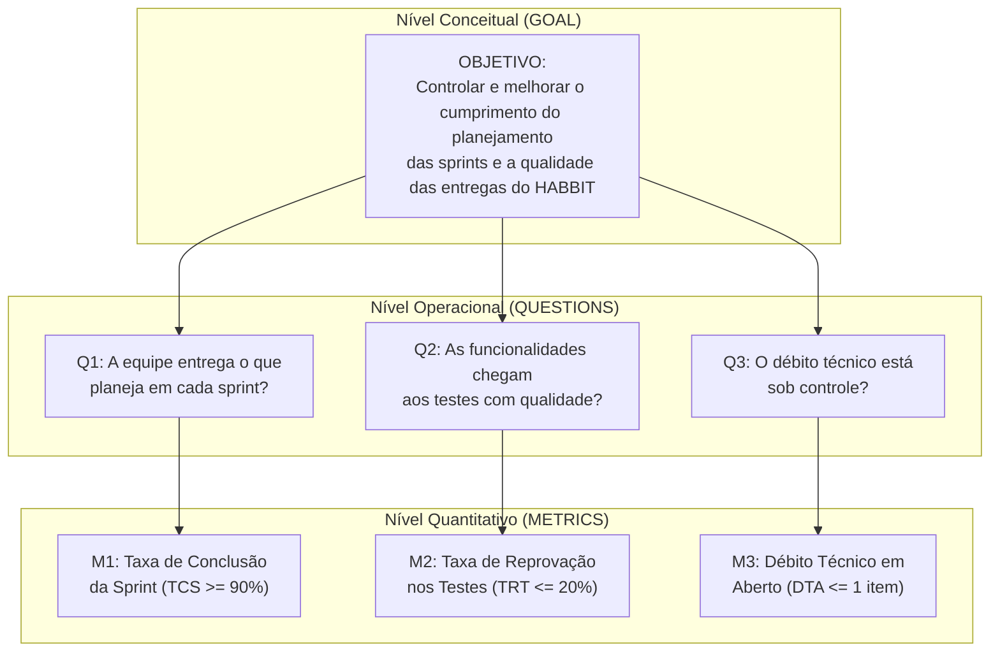
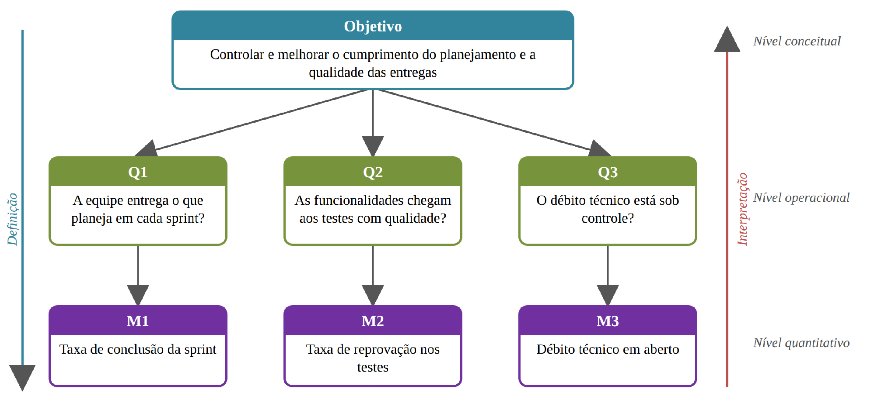

# 4. Métricas e Medições (GQM)

O programa de medição do projeto **HABBIT** estrutura-se segundo o paradigma **GQM (*Goal-Question-Metric*)**, com foco no controle do processo de desenvolvimento descrito na [Seção 2](visao-projeto.md). As métricas avaliam simultaneamente a previsibilidade das entregas semanais, a qualidade do código que chega à etapa de testes e o controle do débito técnico.

---

## 4.1. Estrutura GQM do Projeto

### Quadro 16 — Objetivo de Medição (Molde GQM)

| Dimensão GQM | Definição no Projeto HABBIT |
| :--- | :--- |
| **Analisar** | O processo de desenvolvimento de software do **HABBIT**. |
| **Com o propósito de** | Controlar e melhorar continuamente. |
| **Com respeito a** | Cumprimento do planejamento das sprints e qualidade das funcionalidades entregues. |
| **Sob o ponto de vista da** | Equipe de desenvolvimento e garantia de qualidade (Equipe Shannon). |
| **No contexto do** | Projeto da disciplina de Métodos de Desenvolvimento de Software (UnB / FCTE), desenvolvido por uma equipe de oito integrantes em sprints semanais. |

Para verificar de forma quantitativa se o objetivo conceitual está sendo atingido, foram definidas três questões operacionais (**Q1**, **Q2** e **Q3**), cada qual respondida por um indicador objetivo (**M1**, **M2** e **M3**):

*Figura 4 – Estrutura GQM do projeto relacionando os níveis conceitual, operacional e quantitativo. Fonte: elaborado pelos autores (2026).*

---

## 4.2. Especificação Detalhada das Métricas (5W2H)

Todas as métricas utilizam dados auditáveis registrados no **GitHub Projects** e nas **Issues / Pull Requests** do repositório, sendo apuradas semanalmente ao final de cada sprint pelos **Analistas de Qualidade (QA)**.

### M1 — Taxa de Conclusão da Sprint (TCS)

$$
\text{TCS} = \left( \frac{\text{Itens no estado Done ao fim da sprint}}{\text{Itens planejados no backlog da sprint}} \right) \times 100
$$

| Atributo 5W2H | Especificação |
| :--- | :--- |
| **Questão associada (*Por quê?*)** | **Q1** — A equipe entrega o que planeja em cada sprint? |
| **Definição (*O quê?*)** | Percentual dos itens planejados para a sprint que atingiram o estado **Done** até o fechamento semanal (quarta-feira). |
| **Forma de cálculo (*Como?*)** | $\text{TCS} = (\text{Done} \div \text{Planejados}) \times 100$ |
| **Escala e unidade** | Escala racional; unidade: percentual (`%`), de `0` a `100`. |
| **Tipo de métrica** | Indireta (derivada de duas contagens) e objetiva. |
| **Fonte dos dados (*Onde?*)** | Quadro Kanban da sprint no **GitHub Projects**. |
| **Momento de coleta (*Quando?*)** | Na revisão semanal, ao final de cada sprint. |
| **Responsável (*Quem?*)** | Analista de Qualidade (QA). |
| **Valor esperado (*Quanto?*)** | **$\ge 90\%$** |
| **Ação associada ao limite** | Se $\text{TCS} < 90\%$, a equipe investiga a causa na revisão (impedimentos ou subestimativa de tamanho) e aciona os gatilhos de replanejamento 1 ou 2 ([Seção 3.3](cronograma-riscos.md#33-criterios-de-replanejamento)). |

---

### M2 — Taxa de Reprovação nos Testes (TRT)

$$
\text{TRT} = \left( \frac{\text{Funcionalidades reprovadas nos testes na sprint}}{\text{Funcionalidades testadas na sprint}} \right) \times 100
$$

| Atributo 5W2H | Especificação |
| :--- | :--- |
| **Questão associada (*Por quê?*)** | **Q2** — As funcionalidades chegam aos testes com a qualidade esperada? |
| **Definição (*O quê?*)** | Percentual das funcionalidades que atingiram o estado **Ready** e foram testadas na sprint, mas sofreram reprovação pelo menos uma vez (nos testes de QA ou revisão de PR) e retornaram ao desenvolvimento. |
| **Forma de cálculo (*Como?*)** | $\text{TRT} = (\text{Reprovadas} \div \text{Testadas}) \times 100$ |
| **Escala e unidade** | Escala racional; unidade: percentual (`%`), de `0` a `100`. |
| **Tipo de métrica** | Indireta (derivada de duas contagens), externa (obtida via verificação e testes) e objetiva. |
| **Fonte dos dados (*Onde?*)** | Registros de revisão de *Pull Requests*, execuções do GitHub Actions e Issues de defeito no GitHub Projects. |
| **Momento de coleta (*Quando?*)** | Na revisão semanal, ao final de cada sprint. |
| **Responsável (*Quem?*)** | Analista de Qualidade (QA). |
| **Valor esperado (*Quanto?*)** | **$\le 20\%$** |
| **Ação associada ao limite** | Se $\text{TRT} > 20\%$, a equipe reforça o critério de **Ready**, exigindo validação local completa da suíte (`pytest` / `jest`) e dos critérios de aceite antes da abertura do PR. |

---

### M3 — Débito Técnico em Aberto (DTA)

$$
\text{DTA} = \sum \text{Itens classificados como débito técnico com status em aberto ao fim da sprint}
$$

| Atributo 5W2H | Especificação |
| :--- | :--- |
| **Questão associada (*Por quê?*)** | **Q3** — O débito técnico está sob controle? |
| **Definição (*O quê?*)** | Quantidade absoluta de itens de débito técnico em aberto ao final da sprint. Consideram-se débito técnico: **(a)** soluções provisórias ou atalhos de código que exigem refatoração; e **(b)** testes automatizados pendentes. |
| **Forma de cálculo (*Como?*)** | Contagem simples das Issues rotuladas como débito técnico ainda abertas no encerramento da sprint. |
| **Escala e unidade** | Escala absoluta; unidade: `itens`. |
| **Tipo de métrica** | Direta, interna (relativa ao código-fonte e suíte de testes) e objetiva. |
| **Fonte dos dados (*Onde?*)** | Issues do repositório GitHub identificadas como débito técnico / refatoração. |
| **Momento de coleta (*Quando?*)** | Na revisão semanal, ao final de cada sprint. |
| **Responsável (*Quem?*)** | Analista de Qualidade (QA). |
| **Valor esperado (*Quanto?*)** | **No máximo `1` item em aberto ($\text{DTA} \le 1$)** |
| **Ação associada ao limite** | Se houver mais de `1` item em aberto ($\text{DTA} > 1$), os itens de débito técnico são alocados com prioridade máxima no topo do backlog da sprint imediatamente seguinte. |

---

## 4.3. Coleta e Interpretação Conjunta

Os dados das três métricas são registrados continuamente no GitHub durante a sprint à medida que os cartões transitam entre estados, os pipelines de CI e revisões de QA são executados e eventuais débitos técnicos são abertos ou sanados.

Na revisão semanal, a interpretação ocorre **de baixo para cima** (*bottom-up*, conforme a Figura 4):

1. Cada métrica (**M1**, **M2**, **M3**) responde objetivamente à sua respectiva questão operacional (**Q1**, **Q2**, **Q3**);
2. Considera-se o **Objetivo de Medição integralmente atendido** na sprint quando, simultaneamente:
   - $\text{TCS} \ge 90\%$
   - $\text{TRT} \le 20\%$
   - $\text{DTA} \le 1\text{ item}$
3. Caso qualquer um dos limiares seja violado, a ação corretiva associada à métrica é imediatamente aplicada no planejamento da sprint subsequente.
