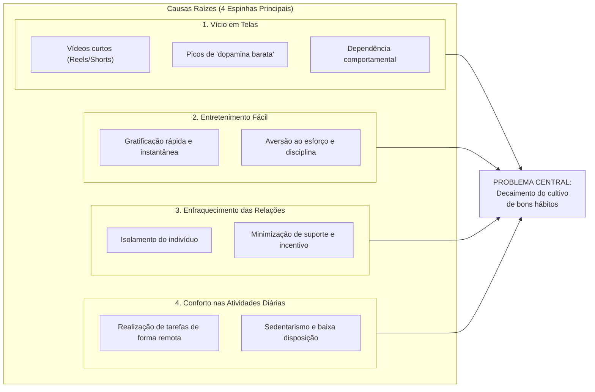
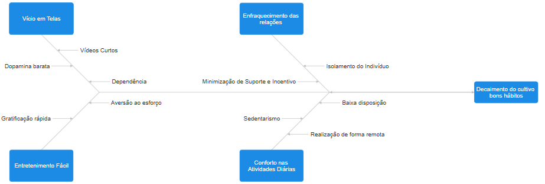

# 1. Visão Geral do Produto

Esta seção apresenta a fundamentação do problema investigado pela **Equipe Shannon**, o posicionamento estratégico do aplicativo **HABBIT**, seus objetivos de negócio e a *stack* tecnológica consolidada na **Versão 3.0**.

---

## 1.1. Problema

De acordo com dados recentes da **PNAD Contínua sobre Tecnologia da Informação e Comunicação** divulgados pelo **IBGE (2026)**, aproximadamente **89,8% da população brasileira com 10 anos ou mais possui telefone celular próprio**. Em meio ao ápice da expansão da internet e da digitalização global, profundas transformações emergem no tecido social e no comportamento individual.

Embora a hiperconectividade traga benefícios inegáveis — como a velocidade na disseminação de informações, a ampliação da comunicação e o intercâmbio cultural —, ela também desencadeou efeitos colaterais severos sobre a saúde comportamental e a disciplina pessoal: **o decaimento sistemático do cultivo de bons hábitos**.

Levantamentos do **Centro Regional de Estudos para o Desenvolvimento da Sociedade da Informação (CETIC.br, 2025)** evidenciam a hegemonia das redes sociais e plataformas de vídeos curtos (*Reels*, *Shorts*, *TikTok*) no consumo diário dos brasileiros. A exposição contínua a estímulos visuais rápidos estimula descargas recorrentes de **"dopamina barata"**, gerando dependência comportamental e perda de longas horas produtivas.

Convergem para esse cenário quatro vetores principais:

1. **Vício em Telas:** O consumo compulsivo de vídeos curtos e feeds infinitos gera picos de dopamina imediata, reduzindo a capacidade de concentração prolongada.
2. **Entretenimento Fácil:** A gratificação instantânea diminui o limiar de tolerância ao esforço, provocando aversão ao labor diário, ao estudo e às atividades que demandam maturação a médio e longo prazo.
3. **Conforto nas Atividades Diárias:** A comodidade de realizar compras, trabalho e lazer de forma integralmente remota fomenta o sedentarismo e reduz a disposição física e mental para rotinas desafiadoras.
4. **Enfraquecimento das Relações:** O isolamento do indivíduo enfraquece as redes presenciais de apoio mútuo, minimizando o suporte comunitário e o incentivo externo indispensáveis para sustentar novos hábitos.

*Figura 1 – Diagrama de Ishikawa sintetizando as causas do decaimento do cultivo de bons hábitos. Fonte: elaborado pelos autores (2026).*

Como consequência indireta desses fatores, o indivíduo afetado sofre queda de autoestima, desânimo e perda de produtividade. Partindo dessa oportunidade, a equipe concebeu o **HABBIT**: um software móvel de controle e estímulo de hábitos que opera em harmonia com o cotidiano digital do usuário, convertendo o smartphone de vetor de distração em instrumento de constância, visualização de progresso e apoio coletivo.

---

## 1.2. Declaração de Posição do Produto

O **HABBIT** é uma aplicação móvel de acompanhamento de hábitos e estímulo contínuo para que o usuário alcance seus objetivos. Com ela, o usuário:

- Cria hábitos categorizados e define **metas periódicas flexíveis** — **diárias** (cumprir todos os dias), **semanais** (cumprir de 1 a 7 dias na semana, escolhendo o dia de fechamento do ciclo) ou **mensais** (cumprir de 1 a 28 dias no mês);
- Registra cada execução por meio de **check-ins** ricos (com título, descrição e duração opcional), podendo vincular um único check-in a múltiplos hábitos relacionados;
- Acompanha sua regularidade por meio de **streaks por período** (*current streak* e *best streak*), **dias de constância** (*consistent days*) e **sequência geral de atividade** (*activity streak*);
- Visualiza sua trajetória em **painéis estatísticos, gráficos de séries temporais e calendário mensal**;
- Recebe **lembretes** e pratica hábitos em **grupos compartilhados** de forma gamificada e saudável, com ranking baseado na regularidade.

### Análise Competitiva e Diferenciação

Durante a etapa de elicitação e estudo de mercado, a equipe analisou três concorrentes diretos:

| Concorrente | Foco Principal | Limitações Identificadas | Diferencial do HABBIT |
| :--- | :--- | :--- | :--- |
| **Gymrats** | Treinos e academia | Restrito ao nicho fitness/exercícios físicos; pouco adaptável a estudos, leitura, sono ou finanças. | Catálogo abrangente de **16 categorias** (de musculação e corrida a leitura, estudos, finanças e mente), moldável a qualquer rotina. |
| **YPT (Yeolpumta)** | Cronômetro de estudos | Focado exclusivamente em contagem de tempo de estudo; carece de gestão ampla de hábitos cotidianos. | Combina check-ins rápidos por frequência com registro opcional de **duração ISO 8601**, sem se limitar a estudos. |
| **Habitica** | RPG gamificado | Interface densa e complexa (UX sobrecarregada por mecânicas de RPG) e ausência de estímulo simples por grupos de amigos com ranking direto. | Experiência limpa (check-in em até 2 toques), indicadores diretos de *streak* e grupos competitivos fáceis de gerenciar. |

### Público-Alvo e Dores Atendidas

O público-alvo principal do **HABBIT** é composto por **jovens adultos entre 18 e 30 anos**, estudantes universitários ou jovens trabalhadores que utilizam o smartphone ao longo de todo o dia e possuem familiaridade com aplicativos móveis e redes sociais.

O questionário aplicado pela equipe revelou três dores predominantes nesse perfil, todas diretamente endereçadas pelo produto:

1. **Falta de motivação para manter o ritmo** $\rightarrow$ Respondida pelos **streaks**, **alertas de hábitos em risco (`at_risk`)** e **ranking de grupos**;
2. **Falta de companhia na jornada** $\rightarrow$ Respondida pelos **grupos de hábito compartilhado**;
3. **Dificuldade em perceber o próprio progresso** $\rightarrow$ Respondida pelo **módulo de estatísticas, séries temporais e calendário mensal**.

### Quadro 1 — Síntese da Declaração de Posição do Produto

| Elemento | Descrição |
| :--- | :--- |
| **Para** | Jovens adultos entre 18 e 30 anos, estudantes ou trabalhadores que usam o celular ao longo de todo o dia e estão familiarizados com aplicativos e redes sociais. |
| **Necessidade** | Criar ou retomar hábitos e mantê-los ao longo do tempo, superando a falta de motivação, a falta de companhia e a dificuldade de perceber o próprio progresso. |
| **O (nome do produto)** | **HABBIT** é um aplicativo móvel de acompanhamento de hábitos. |
| **Que** | Permite registrar cada execução do hábito por check-in (vinculável a múltiplos hábitos), definir metas diárias, semanais ou mensais, manter a constância com streaks e alertas de risco, acompanhar a evolução em estatísticas e calendário mensal e se motivar em grupos com ranking. |
| **Ao contrário** | Do *Gymrats* (restrito a academia), do *YPT* (focado apenas em estudo) e do *Habitica* (complexo e sem apoio direto de grupos com ranking). Sem um produto assim, o usuário depende de anotações soltas ou de aplicativos fragmentados e tende a abandonar o hábito. |
| **Nosso produto** | Reúne em um só lugar registro rápido, metas periódicas flexíveis, indicadores claros de constância, estatísticas visuais, lembretes e prática em grupo com ranking, sem se restringir a um nicho de hábito. |

---

## 1.3. Objetivos do Produto

O objetivo principal do **HABBIT** é **apoiar pessoas na criação, na manutenção e no acompanhamento de hábitos ao longo do tempo**, oferecendo meios práticos de registrar a execução, medir a regularidade e perceber a evolução de cada hábito.

Ele se desdobra em cinco objetivos específicos:

1. **OE-01 — Registro Ágil por Check-in:** Permitir o registro simples e rápido da execução de um ou mais hábitos por meio de check-ins (com título, descrição e duração opcional), base de todas as demais funcionalidades.
2. **OE-02 — Estímulo à Regularidade por Metas e Streaks:** Estimular a constância por meio do motor de metas (diária, semanal e mensal), calculando em tempo real a sequência atual (*current streak*), o recorde histórico (*best streak*), os dias de constância (*consistent days*) e o status do período (`completed`, `in_progress`, `at_risk`, `failed`, `ended`).
3. **OE-03 — Visibilidade da Evolução:** Tornar visível o progresso do usuário por meio de estatísticas consolidadas, séries temporais diárias, taxas de cumprimento e calendário mensal por hábito.
4. **OE-04 — Redução do Esquecimento:** Reduzir falhas por esquecimento através de lembretes e notificações enquanto a meta do período estiver pendente.
5. **OE-05 — Engajamento Social e Competitivo:** Promover apoio mútuo e motivação por meio de grupos com hábitos compartilhados e ranking de membros baseado na constância.

---

## 1.4. Tecnologias Utilizadas (Versão 3.0)

O Quadro 2 consolida o conjunto de tecnologias, frameworks e ferramentas efetivamente adotados no repositório (`apps/api` e `apps/mobile`).

### Quadro 2 — Stack Tecnológica, Métodos e Ferramentas

| Categoria | Tecnologia / Ferramenta | Aplicação no Repositório |
| :--- | :--- | :--- |
| **Linguagem (Back-end)** | **Python 3.13+** | Desenvolvimento da API e motores de cálculo de streaks e estatísticas (`apps/api`). |
| **Framework (Back-end)** | **FastAPI (`>=0.141.1`)** | Exposição da API RESTful, injeção de dependências (`SessionDep`, `get_current_user`) e documentação OpenAPI automática. |
| **ORM, Validação e Migrações** | **SQLModel (`>=0.0.48`)**, **Pydantic v2**, **psycopg 3** e **Alembic (`>=1.20.1`)** | Mapeamento objeto-relacional sobre SQLAlchemy, validação estrita de contratos de entrada/saída e versionamento de schema do banco. |
| **Segurança e Autenticação** | **bcrypt (`>=5.0.0`)** e **PyJWT (`>=2.15.1`)** | Hash seguro de senhas com salt (limite de 72 bytes) e emissão/validação de *access tokens* e *refresh tokens* com controle de sessão em banco. |
| **Gerenciador de Pacotes (Back-end)** | **uv** | Resolução determinística de dependências Python e execução isolada da suíte de testes e linter. |
| **Banco de Dados** | **PostgreSQL 17** | Persistência relacional ACID de usuários, sessões, hábitos, metas, check-ins e grupos. |
| **Front-end Mobile & Web** | **React Native (`0.86.3`)** com **Expo (`~57.0`)** e **TypeScript (`~6.0`)** | Base de código única multiplataforma para Android, iOS e Web (`apps/mobile`). |
| **Roteamento (Front-end)** | **Expo Router (`~57.0.23`)** | Roteamento baseado em arquivos (*file-based routing*) separando rotas públicas `(auth)` e rotas autenticadas `(app)`. |
| **Comunicação e Cache (Front-end)** | **Axios (`^1.20.0`)** e **SWR (`^2.5.1`)** | Cliente HTTP com *interceptors* de renovação automática de JWT e *hooks* reativos de busca, cache e revalidação de dados. |
| **Armazenamento Seguro (Front-end)** | **Expo Secure Store** / **localStorage** | Persistência segura do par de tokens no dispositivo móvel e *fallback* transparente no navegador web. |
| **Estilização e UI (Front-end)** | **StyleSheet Nativo**, **Sistema de Tema (`theme.ts`)**, **`@expo/ui`** e **Lucide Icons** | Estilização padronizada com tokens de cores, tipografia (*Libre Baskerville* e *System*) e variantes de componentes reutilizáveis. |
| **Lint e Formatação** | **Ruff (`>=0.12.4`)** e **Biome** | Garantia automatizada da PEP 8 no Python e padronização de código TypeScript/React Native no monorepo. |
| **Testes Automatizados** | **Pytest (`>=9.1.1`)** + **Testcontainers (`>=4.15.0`)** (Back-end); **Jest (`^30.0`)** + **React Native Testing Library** + **Storybook (`^10.6`)** (Front-end) | Testes unitários, testes de integração com PostgreSQL 17 real em contêiner, testes de componentes/fluxos de tela e catálogo visual isolado. |
| **Infraestrutura e CI/CD** | **Docker Compose**, **GitHub Actions** e **MkDocs Material** | Orquestração local do banco de dados, execução contínua de lint e testes na branch `developer` e deploy da documentação no GitHub Pages a partir da branch `docs`. |
| **Metodologia** | **Scrum** combinado com **Extreme Programming (XP)** | Sprints semanais, priorização MoSCoW, TDD, *Pair Programming*, refatoração contínua e revisão obrigatória por *Pull Request*. |
