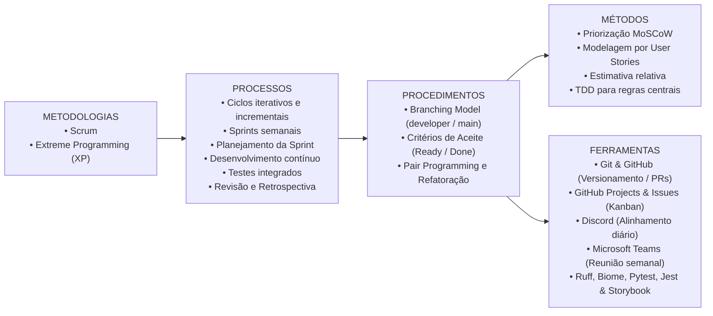
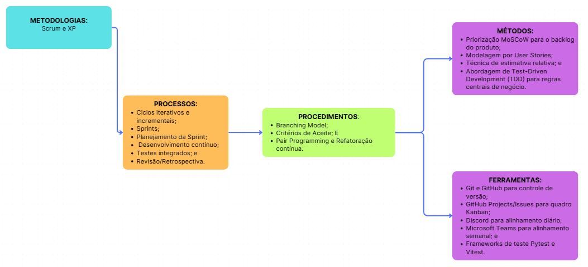
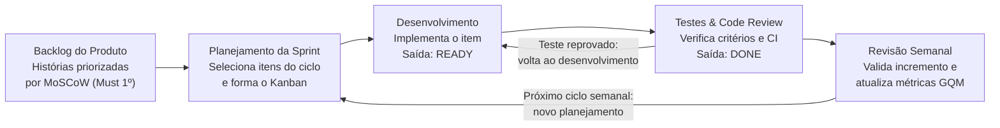
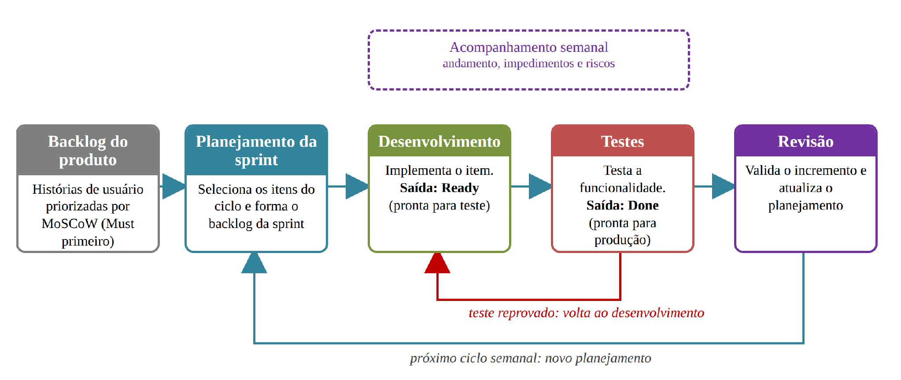

# 2. Visão Geral do Projeto e Processo de Desenvolvimento

Esta seção descreve o ciclo de vida do projeto **HABBIT**, a estrutura organizacional da **Equipe Shannon**, o fluxo semanal do processo de desenvolvimento (Scrum + XP) e os canais de comunicação adotados.

---

## 2.1. Ciclo de Vida do Projeto de Desenvolvimento de Software

O projeto **HABBIT** adota uma abordagem ágil híbrida que combina a governança iterativa do **Scrum** com as práticas de engenharia de software do **Extreme Programming (XP)**.

*Figura 2 – Relação entre metodologia, processo, procedimentos, métodos e ferramentas. Fonte: elaborado pelos autores (2026).*

### Estrutura do Ciclo de Vida

- **Metodologia:** Princípios ágeis focados em entregas frequentes e incrementais de valor, inspeção contínua, adaptação controlada a mudanças e colaboração estreita entre os 8 integrantes.
- **Processo:** Ciclos iterativos semanais (*Sprints*), com fechamento às quartas-feiras, estruturados em Planejamento da Sprint, Desenvolvimento Contínuo, Testes Integrados e Revisão/Retrospectiva.
- **Procedimentos:**
  - **Branching Model (GitFlow adaptado):** Desenvolvimento em branches de funcionalidade (`feature/...`, `feat/...`, `fix/...`), integração contínua revisada na branch `developer`, lançamentos estáveis consolidados na `main` e documentação isolada na branch `docs`.
  - **Critérios de Qualidade:** Transição obrigatória pelos marcos **Ready** (código, critérios de aceite e testes unitários concluídos) e **Done** (testes de regressão e CI verdes, além de *Pull Request* aprovado por par).
  - **Pair Programming e Refatoração Contínua (XP):** Aplicados diretamente nos módulos de maior criticidade algorítmica, como o motor de metas e streaks (`app/goals/streak.py`), o motor de estatísticas (`app/statistics/calculations.py`) e os fluxos de sessão (`app/auth/`).
- **Métodos:** Priorização **MoSCoW** (*Must, Should, Could*), modelagem de requisitos centrada em **User Stories** com critérios de aceite verificáveis e **Test-Driven Development (TDD)** para as regras centrais de negócio.
- **Ferramentas:** Git e GitHub para controle de versão, GitHub Projects e Issues para gestão visual do quadro Kanban e rastreamento de débitos técnicos, Discord para comunicação assíncrona diária, Microsoft Teams para ritos síncronos semanais, Ruff e Biome para padronização de código, e Pytest, Testcontainers, Jest, React Native Testing Library e Storybook para verificação de qualidade.

---

## 2.2. Organização do Projeto

A equipe é organizada em frentes complementares de gestão, desenvolvimento e garantia de qualidade (QA), garantindo que toda entrega de Back-end ou Front-end passe por validação independente.

### Quadro 3 — Organização e Papéis do Projeto

| Papel | Atribuições e Responsabilidades | Responsável Principal | Participantes |
| :--- | :--- | :--- | :--- |
| **Scrum Master** | Facilitar cerimônias ágeis, remover impedimentos operacionais, apoiar o refinamento do backlog com base nos requisitos e validar entregas semanais. | **Pedro Augusto Ornelas Silva** | — |
| **Desenvolvimento Back-end** | Modelar o banco de dados PostgreSQL 17 e migrações Alembic, implementar rotas REST com FastAPI, arquitetura modular em camadas (`Router`, `Service`, `Repository`), autenticação JWT/Sessão e motores de metas e estatísticas. | **Caio Felipe Alcantara Nascimento** | **Pedro Oliveira Melo**, **José Luiz Barros Faria** |
| **Desenvolvimento Front-end** | Desenvolver telas, rotas (Expo Router) e componentes mobile no React Native com Expo (TypeScript), estilização com `StyleSheet`/`theme.ts` e integração reativa com a API via Axios e SWR. | **Breno Gomes Cardoso** | **Isaque Victor Palhares Silva** |
| **Analista de Qualidade Back-end (QA)** | Escrever e manter a suíte de testes unitários e de integração com Pytest e Testcontainers, validar cobertura de código e auditar regras de cálculo de streaks e estatísticas no servidor. | **João Vítor Sauma de Faria** | — |
| **Analista de Qualidade Front-end (QA)** | Implementar testes de componentes, hooks e fluxos de tela com Jest e React Native Testing Library, além de manter o catálogo de componentes no Storybook. | **Isaque Ladeira Esteves** | — |
| **Dono do Produto (Product Owner)** | Priorizar e refinar o backlog do produto, deliberar sobre alterações de escopo e validar as entregas ao fim de cada sprint. | **Professor da Disciplina** | Monitores da disciplina e representantes do público-alvo |

---

## 2.3. Processo de Desenvolvimento de Software

O processo de engenharia do **HABBIT** opera em ciclos semanais (fechamento às quartas-feiras), priorizando primeiro os requisitos essenciais (**Must** — que compõem o MVP) e incorporando os itens **Should** e **Could** nas sprints subsequentes conforme a capacidade medida da equipe.

### Quadro 8 — Eventos e Atividades do Processo

| Evento / Atividade | Periodicidade | Objetivo Operacional |
| :--- | :---: | :--- |
| **Planejamento da Sprint** | Semanal | Selecionar as User Stories do backlog do produto (priorizando *Must*), quebrar em tarefas técnicas de Back-end, Front-end e QA e compor o quadro Kanban da sprint. |
| **Desenvolvimento** | Contínuo (durante a sprint) | Implementar código, migrações e testes unitários em branch própria até atingir o estado **Ready**. |
| **Acompanhamento** | Semanal / Assíncrono | Monitorar o progresso dos cartões no GitHub Projects, identificar bloqueios e acompanhar indicadores de risco. |
| **Testes e Revisão de PR** | Contínuo / Semanal | Executar as suítes automatizadas (CI no GitHub Actions + validação de QA) e revisar o *Pull Request* até atingir o estado **Done**. |
| **Revisão e Retrospectiva** | Semanal | Avaliar o incremento integrado na branch `developer`, coletar as métricas GQM (`M1`, `M2`, `M3`) e ajustar o planejamento da sprint seguinte. |

### Marcos de Qualidade: Ready e Done

| Marco | Definição e Critérios Obrigatórios |
| :--- | :--- |
| **Definição de Preparado (*Ready for Test*)** | O código e os testes unitários foram concluídos pelo desenvolvedor, a funcionalidade atende integralmente aos critérios de aceite da *User Story*, o linter (Ruff ou Biome) passa sem erros e o *Pull Request* foi aberto para a branch `developer`. |
| **Definição de Pronto (*Done*)** | Todos os testes de integração e regressão foram aprovados no GitHub Actions, o *Pull Request* foi revisado e aprovado por outro integrante da equipe e o código foi mesclado à branch `developer`. |

!!! warning "Fluxo de Reprovação em Testes"
    Quando uma funcionalidade em estado **Ready** apresenta falha na revisão ou nos testes de verificação, ela **não atinge o estado Done**, retorna imediatamente à etapa de **Desenvolvimento** e contabiliza na métrica **M2 (Taxa de Reprovação nos Testes)**.

*Figura 3 – Fluxo de trabalho do processo de desenvolvimento. Fonte: elaborado pelos autores (2026).*

---

## 2.4. Matriz de Comunicação

### Quadro 5 — Matriz de Comunicação da Equipe

| Descrição da Atividade | Área / Envolvidos | Periodicidade | Canal | Produtos Gerados |
| :--- | :--- | :---: | :---: | :--- |
| **Acompanhamento das atividades em andamento** (*check-in* do que cada integrante fez, está fazendo e eventuais bloqueios) | Equipe Shannon | Semanal | Discord / Teams | Ata de reunião e Quadro Kanban atualizado no GitHub Projects |
| **Planejamento da Sprint** | Equipe Shannon | Semanal | Microsoft Teams | Quadro Kanban inicial da sprint e Issues atribuídas |
| **Comunicação de situação do projeto** | Equipe, Professor e Monitores | Semanal | Presencial / GitHub | Ata de reunião e Relatório de situação do projeto |
| **Acompanhamento de riscos, compromissos, ações pendentes e métricas GQM** | Equipe Shannon (liderado por SM e QA) | Quinzenal | Microsoft Teams / GitHub | Relatório de situação do projeto e atualização da Matriz de Riscos |
